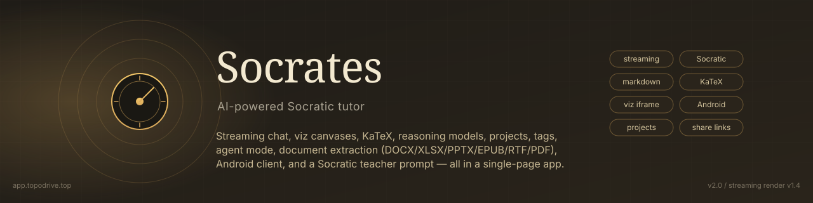
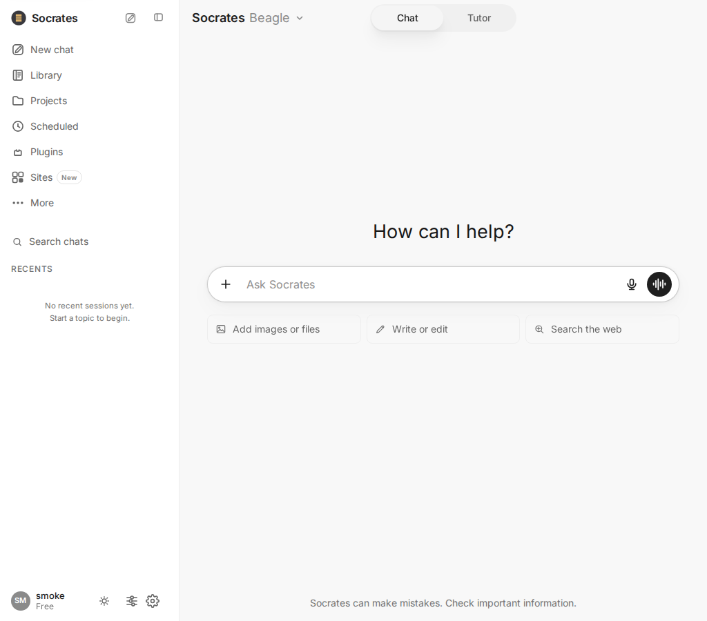
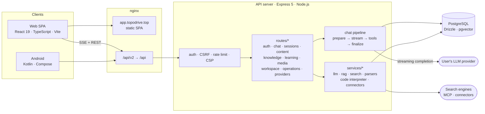
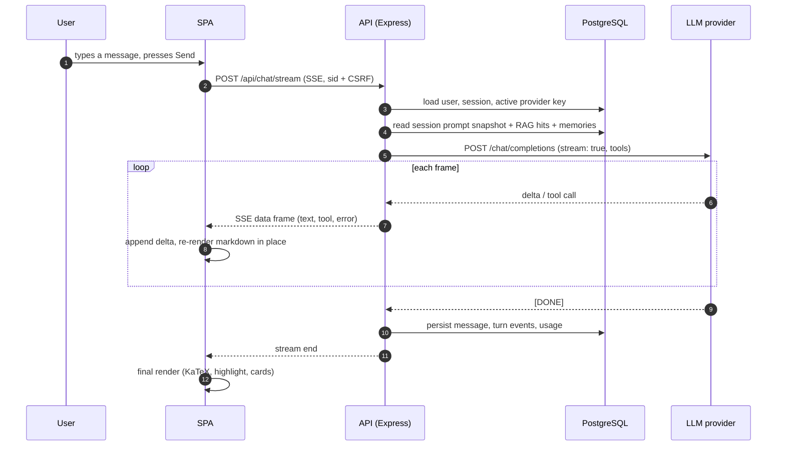

<div align="center">



<br/>

[](https://github.com/kevenhu001-cyber/Socrates/actions/workflows/ci.yml)
[](frontend/)
[](server/)
[](apps/socrates-android/)
[](#license)

**Socrates — an AI tutor for people who want to understand.**

Socrates is a full-stack learning workspace. A Socratic teacher prompt, streaming chat with
reasoning models, generated learning cards, a knowledge-boundary graph, diagnostics, exams and a
mistake book share one conversation surface with document extraction, web research, a Python
sandbox, connector-backed tools and a native Android client.

[中文说明](README.zh.md) · [Live app](https://app.topodrive.top/) · [Marketing site](https://topodrive.top/) · [OpenAPI spec](docs/api/openapi.yaml) · [Architecture map](docs/architecture/mental-model.md)

</div>

---

## Contents

- [What Socrates is](#what-socrates-is)
- [Screenshots](#screenshots)
- [What it does](#what-it-does)
- [Architecture](#architecture)
- [Tech stack](#tech-stack)
- [Repository layout](#repository-layout)
- [Getting started](#getting-started)
- [Configuration](#configuration)
- [Quality gates](#quality-gates)
- [Continuous integration](#continuous-integration)
- [Deployment](#deployment)
- [Security model](#security-model)
- [Documentation map](#documentation-map)
- [Contributing](#contributing)
- [License](#license)
- [Support](#support)

---

## What Socrates is

Most AI chat products are a textarea and a transcript. Socrates is built around a different
premise: **understanding is produced by a question, not by an answer.** The shipped
[`prompts/teacher-mode.md`](prompts/teacher-mode.md) system prompt turns the model into a patient
teacher that leads with examples, asks before telling, and replaces "you are wrong" with
"look at it from another angle":

> 就像一位耐心温和的老师在跟你聊天。平时正常对话，不刻意教东西。
>
> - 对方问问题或遇到困难时，再拿出老师的引导感
> - 对方只是闲聊（比如打招呼），正常回应就好
> - 讲东西时先举例子再讲概念，用"换个角度想想"代替"你错了"
> - 偶尔用引导式提问代替直接给答案

Everything else in the repository exists to make that interaction hold up in daily use: a
transport that renders the model's output while it is still being written, a set of learning
records that survive the session, and the ordinary workspace furniture (projects, files, search,
sharing) that a tool needs once it has more than three conversations.

The product ships as **two first-party clients** over one API: a Vite/React web SPA and a
standalone Kotlin/Compose Android app. Both speak `/api/v2` (nginx rewrites it to the server's
`/api`), and both share protocol and session types through `packages/contracts` and
`packages/core`.

## Screenshots

These are the reference captures the visual regression suite compares against
(`docs/assets/parity-2026-10-19/`), not marketing renders. The UI is bilingual; the Chinese
captures show the default locale.

<div align="center">

| Home — dark | Home — light |
| --- | --- |
|  |  |

| Narrow viewport — English | |
| --- | --- |
|  | |

</div>

## What it does

### Teach and learn

- **Tutor mode.** The composer's mode switch swaps in the teacher prompt and the learning
  pipeline; chat mode leaves the model as a general assistant. The two share one transcript, so a
  conversation can move between explaining and asking.
- **Learning modes.** `prompts/learning-modes.md` defines server-owned behaviour per mode (focus,
  practice, review, …). The client sends only a mode id; the pedagogy stays on the server and is
  injected for the current turn only.
- **Learning cards.** The model answers with a typed `{version:1,nodes:[...]}` envelope and the
  client renders native blocks — steps, accordions, images, badges, demonstrations — instead of
  raw HTML. Anything the contract cannot express degrades to prose.
- **Knowledge boundary.** A deterministic force-directed graph of what the learner has
  internalised, is fuzzy about, or has not touched, with confidence, notes and change history per
  node.
- **Diagnostics and exams.** A diagnostic flow generates questions, scores answers by rule,
  reports insight and can be re-run. Exams are generated, persisted server-side, answered and
  reviewed with the same scoring path.
- **Mistake book and review.** Mistakes are collected per session and across sessions, grouped for
  practice, and resurfaced through a spaced-repetition review deck and question chains.

### Converse

- **Streaming chat over SSE**, with a purpose-built progressive markdown renderer: headings, lists,
  fences, blockquotes and inline emphasis appear the moment their opener arrives, and the final
  pass upgrades the same DOM with KaTeX, syntax highlighting and interactive cards.
- **Reasoning models.** ` thinking…</think>` blocks stream into a collapsible card while the text
  before and after them still renders as live HTML.
- **Per-message actions** — copy, edit, delete, regenerate, branch, re-explain from another angle,
  feedback — plus in-session find (`Ctrl/⌘-F`), global search (`Ctrl/⌘-K`), a slash-command
  palette, prompt templates and a keyboard cheatsheet.
- **Attachments.** Images and audio go to a multimodal provider; PDF, DOCX, XLSX, PPTX, EPUB and RTF
  are parsed to text server-side before they enter the context.
- **Tools during a turn.** Web search (MiniMax, Bing, SearXNG and Firecrawl behind one interface),
  page fetch, Python execution, image search, memory writes, connector calls, site creation and
  visualization rendering all run through the same tool loop and surface as inspectable tool cards.

### Work in a workspace

- **Projects** with per-project instructions and a memory scope (`default` or `project-only`), so a
  project chat cannot read personal memories it was not meant to see.
- **Library and creations.** Uploaded files, generated artifacts and published pages have one
  browsable home with search, metadata, rename, delete and "attach to conversation".
- **Plugins and connectors.** MCP servers, OOMOL-hosted OpenConnector apps and project-scoped
  connectors are installed per account and offered to the model as tools.
- **Scheduled tasks and background runs.** Cron-like tasks, durable workspace-agent runs and
  research jobs keep executing after the tab closes, with leases, replayable events and artifacts.
- **Sharing.** Read-only session links and public sites (`/s/:token`) with the same transcript
  renderer in a forced read-only mode.
- **Usage and keys.** Per-user token accounting, a usage dashboard, and bring-your-own-key provider
  configuration.

## Architecture

The repository is a monorepo of independent npm projects (no workspace hoisting): one SPA, one API
server, four shared packages, one Android app, a static marketing site, and a Rust crate group.



**Server boundaries.** `routes/<domain>/` owns HTTP concerns (authentication, scope, validation,
status codes); `services/<domain>/` owns reusable domain work and may not import HTTP composition;
`lib/` holds neutral primitives. `routes/chat/prepare/` assembles a request (wire schema, prompt
snapshot, RAG, memory, tool catalogue, limits) and `routes/chat/pipeline/` executes exactly one
streaming turn (tool loop, SSE frames, finalisation). The boundary is enforced by
`server/scripts/check-service-boundaries.mjs`.

**Client boundaries.** `frontend/src/chat/` (transport, session, streaming) never imports
`frontend/src/react/`; the allowed shared contract is `frontend/src/react/types/`. React reads and
writes state through the typed hooks in `frontend/src/store/`, not through window globals. Shared
presentational components live in `packages/ui/` as plain React DOM components and are mounted
through narrow subpaths; `packages/*` must stay DOM-free, which
[`scripts/check-packages-dom.mjs`](scripts/check-packages-dom.mjs) enforces.

### One chat turn



The live SSE request is the primary path. `/api/chat-turns` exists so a reload or a dropped
connection can replay the events of a turn that is still running; it is a recovery channel, not a
second transport. A turn is claimed atomically before preparation, so a duplicate submit receives a
`CONFLICT` with a reconnect id instead of executing the tools twice.

### Streaming renderer

Two renderers share one module, [`frontend/src/render/markdown.ts`](frontend/src/render/markdown.ts):

| Renderer | Used when | What it does |
| --- | --- | --- |
| `formatMsgProgressive` | every animation frame while streaming | line-by-line state machine; emits headings, lists, fences, quotes and inline emphasis as soon as the syntax is complete |
| `formatMsg` | turn finished, history reopened, copy/export | full pipeline: `marked` + KaTeX + highlight.js + visualization/card mounting |

Chat-template leakage (`<|im_start|>`, `[INST]…[/INST]`) is stripped once per frame so it never
flickers on screen, and escaping uses nonce placeholders rather than escape-then-restore, which
breaks when a message legitimately contains `<code>`.

## Tech stack

| Layer | Technology | Notes |
| --- | --- | --- |
| Web client | React 19, TypeScript, Vite | [`frontend/`](frontend/); the static shell hosts React islands through one root registry |
| Client state | Zustand readers over an immutable bridge | [`frontend/src/store/`](frontend/src/store/) |
| Rich text | TipTap 3 | composer only; the transcript body stays server-rendered HTML |
| Visualization | tldraw 5.5, Three.js, Mermaid, ECharts, Plotly, MapLibre | lazily loaded, Web-only islands |
| Math & code | KaTeX, highlight.js | vendored UMD under `frontend/src/vendor-files/`, no CDN fallback |
| Markdown | `marked` 13 + custom progressive renderer | see [Streaming renderer](#streaming-renderer) |
| API | Node.js 20.19+/22.12+/24+, Express 5, TypeScript | [`server/`](server/) |
| Data | PostgreSQL 16 + pgvector, Drizzle ORM 0.45 | CI and the OCI image run `pgvector/pgvector:pg16`; migrations in [`server/drizzle/`](server/drizzle/) |
| Retrieval | BM25 chunks + optional pgvector re-ranking, embeddings service | degraded mode when no embedding provider is configured |
| Python sandbox | Pyodide in a bounded worker pool | [`server/src/services/codeInterpreter/`](server/src/services/codeInterpreter/) |
| Workspace agent | `pi` coding agent under Bubblewrap | filesystem/PID isolation, not a full execution-node policy |
| Observability | OpenTelemetry traces + metrics (OTLP/HTTP) | off unless `OTEL_EXPORTER_OTLP_ENDPOINT` is set |
| Shared packages | `@socrates/core`, `@socrates/contracts`, `@socrates/theme`, `@socrates/ui` | [`packages/`](packages/), DOM-free, linked by path |
| Android | Kotlin, Jetpack Compose, Gradle | [`apps/socrates-android/`](apps/socrates-android/) |
| Native helpers | Rust crates: protocol, format, stream, fetch, wasm | [`tools-rust/`](tools-rust/) |
| Marketing site | Static HTML/CSS/JS with its own Node test suite | [`site/`](site/) |
| CI | GitHub Actions: CI gate, server, security, OCI image, Android, agent tooling | [`.github/workflows/`](.github/workflows/) |
| Edge | nginx: static SPA + `/api/v2` reverse proxy + CSP include | [`ops/nginx/`](ops/nginx/) |

## Repository layout

```text
Socrates/
├── frontend/                 Vite SPA — the only production web client
│   ├── index.html            static shell, mount hosts, CSP hashes
│   ├── src/
│   │   ├── main.ts           boot composition (batchStorage.ts first)
│   │   ├── app/ auth/        startup, auth gate, legacy bridge
│   │   ├── chat/             transport, turns, streaming, send pipeline
│   │   ├── session/          history, paging, persistence
│   │   ├── render/           progressive + full markdown renderers
│   │   ├── tutor/ exam/      teaching flows, diagnostics, exams
│   │   ├── react/            React surfaces (islands + pages)
│   │   ├── store/            typed state factory and hooks
│   │   ├── styles/           single CSS entry, ordered cascade
│   │   └── vendor-files/     vendored UMD libraries
│   ├── e2e/                  Playwright suites (smoke/regression/theme/visual)
│   ├── test/                 Node unit tests
│   └── dev-stub/             local API stub used by `vite dev`
├── server/                   Express API
│   ├── src/
│   │   ├── index.runtime.ts  runtime entry (index.js is the systemd shim)
│   │   ├── app.ts            middleware order + router mounts
│   │   ├── boot/             startup and lifecycle stages
│   │   ├── routes/           auth, chat, sessions, content, knowledge,
│   │   │                     learning, media, workspace, operations, providers
│   │   ├── services/         llm, rag, search, parsers, sandbox, connectors
│   │   ├── db/               Drizzle schema and client
│   │   └── lib/              neutral primitives
│   ├── drizzle/              SQL migrations + metadata
│   └── test/                 per-file test suite
├── packages/
│   ├── core/                 SSE framing, turn runtime, learning/exam models
│   ├── contracts/            cross-client protocol types
│   ├── theme/                design tokens shared by web and native
│   └── ui/                   shared React DOM components (narrow subpaths)
├── apps/socrates-android/    standalone Kotlin + Compose client
├── site/                     marketing site (EN + zh), tests, OpenAPI export
├── tools-rust/               Rust crates and the WASM build
├── prompts/                  teacher mode, learning modes, provider prompts
├── docs/
│   ├── architecture/         current system description — start here
│   ├── adr/                  architecture decision records
│   ├── api/openapi.yaml      HTTP contract (OpenAPI 3.1)
│   ├── audits/               dated, immutable review snapshots
│   ├── plans/                dated plans and handoffs
│   ├── ref/                  reference captures and measurement playbooks
│   ├── ops/runbook.md        operational runbook
│   └── STRUCTURE.md          where a new document belongs
├── scripts/                  guards, generators, CI utilities
├── ops/nginx/                CSP snippet, proxy examples, perf config
├── tasks/                    active task ledger + frozen historical evidence
├── test/                     root tests (site, OpenAPI, affected-test mapping)
├── chat-demo/                vendored upstream DeepSeek client — read-only reference
├── deploy.sh                 production release script
├── AGENTS.md                 engineering rules for agents and contributors
└── README.md / README.zh.md
```

## Getting started

### Prerequisites

- **Node.js** `^20.19` or `^22.12` or `>=24` (the server declares this range; Volta pins 22.23.1)
- **PostgreSQL 16** with the `vector` extension (the version CI and the OCI image use) for semantic retrieval
- **npm 10+**
- Optional: Rust toolchain (`tools-rust/`), JDK 17 + Android SDK 35 (Android client)

### 1. Clone and install

Each project owns its lockfile, so install at each level:

```bash
git clone https://github.com/kevenhu001-cyber/Socrates.git
cd Socrates

npm ci                    # root tooling: prettier, yaml, playwright
npm --prefix server ci
npm --prefix frontend ci
```

### 2. Database

```bash
createdb socrates
```

Migrations create the schema. Migration `0031` installs pgvector when the extension is available
and skips the vector column when it is not — retrieval then runs BM25-only instead of failing.

### 3. API server

```bash
cd server
cp .env.example .env      # set DATABASE_URL and SESSION_SECRET at minimum
npm run db:migrate
npm run dev               # http://localhost:8080
```

`SESSION_SECRET` is mandatory when `NODE_ENV=production` (it encrypts stored provider keys); local
development falls back to a development secret. `server/.env.example` lists every variable the
process reads, grouped by feature.

### 4. Web client

```bash
cd frontend
API_PORT=8080 npm run dev    # http://localhost:5173
```

The Vite proxy targets port `3037` by default; either point it at the server (`API_PORT=8080`) or
run the server on `3037` (`PORT=3037 npm start`). When no API is listening, the dev server answers
with the local stub in `frontend/dev-stub/` so the shell and composer stay usable;
`LOCAL_AUTH_BYPASS=0 npm run dev` disables that path.

Production build:

```bash
cd frontend
npm run build                # → frontend/dist/
```

### 5. Android client (optional)

```bash
cd apps/socrates-android
./gradlew assembleDebug testDebugUnitTest lintDebug
```

Requires JDK 17 and Android SDK 35 / Build Tools 35.0.0; point `ANDROID_HOME` or a local
`local.properties` at the SDK. See [`apps/socrates-android/README.md`](apps/socrates-android/README.md)
for API configuration, network-security policy and the current feature-parity status.

## Configuration

The server is configured entirely through environment variables; the SPA stores its settings in the
browser and reads no config from disk.

| Variable | Required | Default | Purpose |
| --- | --- | --- | --- |
| `DATABASE_URL` | yes | — | PostgreSQL connection string |
| `SESSION_SECRET` | production | dev fallback | HKDF seed for the AES keys that encrypt stored provider credentials |
| `PORT` | no | `8080` | HTTP listen port |
| `NODE_ENV` | no | `development` | `production` enables fail-fast secrets, secure cookies and quieter logs |
| `APP_URL` / `CORS_ALLOWED_HOSTS` | no | — | Public origin and allowed cross-origin hosts |
| `BEAGLE_SYSTEM_KEY` | no | — | Seeds the built-in "Beagle" provider so a fresh install works without user keys |
| `OOMOL_PROJECT_API_KEY` | no | — | OOMOL-hosted connector runtime used by the app integrations |
| `SMTP_*` | no | — | Verification mail, password reset |
| `OTEL_EXPORTER_OTLP_ENDPOINT` | no | — | Turns tracing on; unset loads no SDK at all |
| `INTERNAL_METRICS_TOKEN` | no | — | Enables `GET /api/_internal/metrics` behind a bearer token |
| `SCHEDULER_ENABLED` | no | on | `0` disables automatic scheduled-task polling |
| `PI_AGENT_ENABLED` / `PI_AGENT_ISOLATION` | no | on / `bubblewrap` | Workspace-agent toggle and isolation mode |
| `EXEC_*` | no | see template | Python sandbox limits: pool size, timeouts, output and artifact caps |

`server/.env.example` is the authoritative list (114 variables at the time of writing), grouped by
core server, chat, workspace agent, sandbox, connectors, mail, admin, observability and Android.

## Quality gates

Nothing in this repository is "done" until the relevant gates pass. They are cheap to run
individually and expensive to run all at once, so the tooling is built for targeted verification.

```bash
npm run lint          # frontend lint chain + server boundaries + drizzle, docs,
                      # shims, markers, formatting, core declarations, action pinning
npm run typecheck     # server + frontend
npm run verify        # typecheck + lint + shared-package tests
npm run test:fast     # tests mapped to the files you actually changed
```

`npm run lint` is not just `tsc` plus ESLint. It ends in roughly thirty ratchets that freeze a
debt count and may only shrink: raw `<button>` elements, off-ladder control heights, literal
`z-index`, `!important` and hex colours in live CSS, dead rules in frozen CSS, explicit `any`,
empty `catch` blocks, forwarding shims, untyped frontend JS, orphan modules, leaked external hosts,
unpinned GitHub Actions, CSP drift, OpenAPI drift, Drizzle snapshot drift and more. The full table
with what each guard protects lives in [`AGENTS.md`](AGENTS.md).

Focused suites:

| Command | Scope |
| --- | --- |
| `npm --prefix frontend run test:unit` | frontend unit tests (Node test runner via `tsx`) |
| `npm --prefix server run test` | one process per test file; DB suites skip without a database |
| `npm --prefix server run test:db:memory` | PGlite + real migrations + pgvector, no PostgreSQL service |
| `npm --prefix frontend run test:e2e:smoke` | Playwright smoke tier |
| `npm --prefix frontend run test:e2e:required` | smoke + regression + theme (the blocking set) |
| `npm --prefix frontend run test:e2e:visual` | screenshot/golden geometry (advisory) |
| `npm run test:site` | marketing site layout, content, fonts, motion, OpenAPI export |
| `npm run test:openapi` | published OpenAPI document |

Server tests refuse to run against a database whose name does not contain a separated `test` or
`qa` component; `TEST_DATABASE_URL` takes precedence over `.env`.

## Continuous integration

| Workflow | Trigger | What it proves |
| --- | --- | --- |
| [`ci.yml`](.github/workflows/ci.yml) | push, PR | change classification → repo sanity, site, frontend (lint, build, bundle budget, unit, required e2e), server, shared packages + Rust protocol; a single `gate` job |
| [`server-ci.yml`](.github/workflows/server-ci.yml) | server paths | full server suite against real PostgreSQL, boundary and lint checks |
| [`security.yml`](.github/workflows/security.yml) | push, PR, weekly | CodeQL, dependency audit against the shrink-only advisory baseline, SBOM |
| [`image.yml`](.github/workflows/image.yml) | server paths | builds and verifies a signed OCI image of the API; it does **not** deploy |
| [`native-android-build.yml`](.github/workflows/native-android-build.yml) | Android paths | `assembleDebug`, unit tests, lint, debug APK artifact |
| [`agent-tooling-ci.yml`](.github/workflows/agent-tooling-ci.yml) | tool-calling paths | server tooling and frontend agent-UI checks |

Coverage is measured per project over its own `src/**`, advisory on pull requests and blocking on
`main`. Theme and contrast specs are blocking; screenshot and golden-geometry specs are advisory.

## Deployment

Production is a single nginx host plus a systemd unit (`socrates-api`). [`deploy.sh`](deploy.sh) is
the only supported release path:

```bash
./deploy.sh                 # SPA build + backend build + migrations + restart + gates
./deploy.sh --site-only     # publish site/ only; no build, migration or restart
./deploy.sh --require-ci    # also require a green GitHub Actions run before deploying
```

A full release installs lockfile-pinned dependencies, builds the SPA into the web root, compiles
the server into an isolated candidate directory and swaps it in only after the build succeeds
(keeping `dist.previous/`), runs migrations, restarts the service, then validates the result:
frontend document checksum, `/api/health` from the host, the status page bytes and the public DNS
path. If a restart or health gate fails, the previous backend build is restored automatically and
the script exits non-zero. Deployments are serialized with `flock`; a second invocation exits
immediately.

The CI merge gate is **advisory by default** — a red run is recorded in `.deploy-state.json` but
does not block — and becomes enforcing with `--require-ci` or `DEPLOY_REQUIRE_CI_CHECK=1`. A
rollback of application code does **not** roll back a database migration; the runbook in
[`docs/ops/runbook.md`](docs/ops/runbook.md) covers backup, isolated restore drills and the exact
manual rollback commands.

The server is stateless beyond PostgreSQL, so horizontal scaling is a matter of more processes
behind the same nginx. `image.yml` already builds an OCI image on every push; switching deployment
to pull that digest instead of building on the host is a separate, deliberately unmade change.

## Security model

- **Authentication.** bcrypt password hashes; 64-character session tokens in an `HttpOnly`,
  `SameSite=Lax` `sid` cookie with server-side expiry. Login attempts are rate-limited and locked
  out per account and IP.
- **CSRF.** Double-submit cookie: the SPA echoes the `csrf` cookie in `X-CSRF-Token`, and
  state-changing requests without a match are rejected.
- **Provider keys.** Encrypted at rest with a key derived from `SESSION_SECRET`; the browser only
  ever receives a masked preview, and the proxy holds the plaintext for one request.
- **Content Security Policy.** One generated source produces both the Express header and the nginx
  snippet, including the `sha256` hashes of the pre-paint inline scripts in `index.html`;
  `frontend` lint fails when either drifts. `script-src` carries `'unsafe-inline'` deliberately:
  viz cards are model-authored inline-script documents inside `srcdoc` iframes, which inherit the
  parent policy, so a hash-only policy disables every interactive visualization. The hashes are
  still generated so the policy can be tightened once those documents are served from a real
  same-origin URL.
- **Sandboxed rendering.** Model-authored HTML/SVG runs in `sandbox="allow-scripts"` iframes without
  `allow-same-origin`, so it cannot reach the parent DOM or the user's cookies.
- **Uploads.** Non-image files are served with `Content-Disposition: attachment`; HTML/XHTML uploads
  are rejected at the multer layer.
- **Code execution.** Python runs in Pyodide workers with per-run timeouts, output/artifact caps, a
  scratch directory TTL and an optional CJK font bundle; no host Python process is involved.
- **Workspace agent.** `pi` runs inside Bubblewrap with only the turn's workspace writable; the host
  home, application secrets and other workspaces are hidden. Isolation failure refuses the run
  rather than falling back to host execution. This is filesystem/PID isolation, not a complete
  multi-tenant execution policy — network egress and cgroup quotas belong to the host.
- **Operations.** `GET /api/_internal/metrics` is disabled unless `INTERNAL_METRICS_TOKEN` is set,
  and then requires a bearer token; scrapes are excluded from business metrics.

## Documentation map

`docs/` distinguishes **current specification** from **history**. Read the left column as truth, the
right column as rationale.

| Path | What it is | Trust it for |
| --- | --- | --- |
| [`docs/architecture/mental-model.md`](docs/architecture/mental-model.md) | composition roots, one turn, state ownership, server boundaries | how the system works today — start here |
| [`docs/architecture/README.md`](docs/architecture/README.md) | index and reading rules | which document to trust |
| [`docs/architecture/naming.md`](docs/architecture/naming.md) | file/type naming rules | where a new module belongs |
| [`docs/architecture/ui-structure.md`](docs/architecture/ui-structure.md) | frontend architecture in detail (Chinese) | UI lifecycle, styling ownership, migration debt |
| [`docs/adr/`](docs/adr/README.md) | architecture decision records | why a decision was made, and what was rejected |
| [`docs/api/openapi.yaml`](docs/api/openapi.yaml) | OpenAPI 3.1 contract | request/response shapes shared by web, Android and server |
| [`docs/audits/`](docs/audits/README.md) | dated review snapshots | history only — several describe trees that no longer exist |
| [`docs/plans/`](docs/plans/) | dated plans and handoffs | intent and sequencing, not current behaviour |
| [`docs/ref/`](docs/ref/) | reference captures and measurement playbooks | the measurement they record, at its date |
| [`docs/ops/runbook.md`](docs/ops/runbook.md) | release, rollback, backup and restore | operating the production host |
| [`docs/STRUCTURE.md`](docs/STRUCTURE.md) | where a new document goes | documentation placement |
| [`AGENTS.md`](AGENTS.md) | ownership map, risk routes, guard table, testing rules | the engineering contract |

## Contributing

PRs from outside the core team are not currently accepted. Bug reports and feature requests are
welcome at [help@addtech.site](mailto:help@addtech.site).

For contributors with write access:

1. Branch from `main` (`git checkout -b pX.Y/short-name`).
2. Keep the change scoped and add focused regression coverage — not a full-suite run.
3. Verify with the smallest relevant gate: `npm run test:fast`, a single `test:one` file, or one
   Playwright spec. Run `npm run lint` before pushing.
4. Open a PR and squash-merge.

Read [`AGENTS.md`](AGENTS.md) before touching `frontend/src/main.ts`, `server/src/app.ts`, auth,
migrations or `deploy.sh`: it lists the high-churn surfaces, the guard ratchets and the required
verification per area.

## License

Code in this repository that the copyright holder owns or is authorised to license is available
under a custom **source-available** license, not an OSI-approved open-source license. You may use,
modify and redistribute the original or modified covered code free of charge for non-commercial
purposes provided you retain the copyright and license notices. Commercial use requires separate
authorisation. Third-party components remain under their own licenses.

See [`LICENSE`](LICENSE) for the full bilingual terms and [`site/terms.html`](site/terms.html) for
end-user terms. The vendored [`chat-demo/`](chat-demo/README.md) tree is MIT-licensed upstream code
and is not a Socrates component.

## Support

- **Product and account issues** — [help@addtech.site](mailto:help@addtech.site) or the in-app Help
  entry.
- **API questions** — read [`docs/api/openapi.yaml`](docs/api/openapi.yaml) first, then
  [`docs/architecture/mental-model.md`](docs/architecture/mental-model.md) for the server
  boundaries.
- **Android build failures** — confirm JDK 17, Android SDK 35 and the Gradle versions pinned in the
  project; the `native-android-build.yml` log carries the full stack trace.

<div align="center">

Built with care, for learners everywhere.

[中文说明 →](README.zh.md)

</div>
