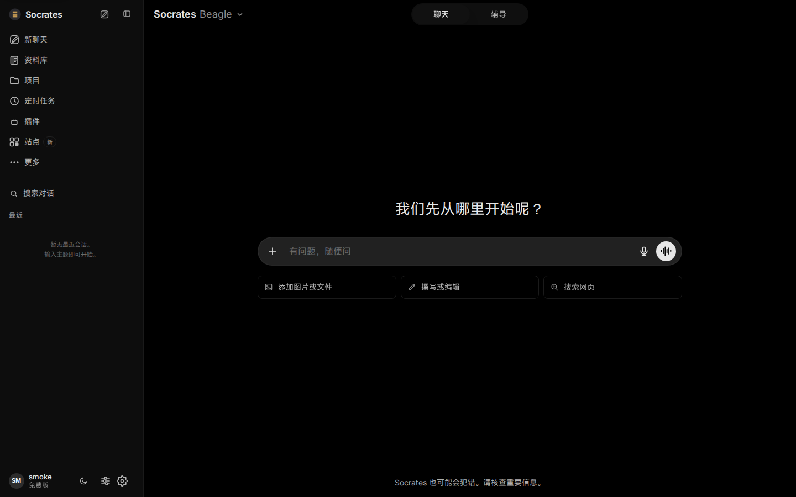
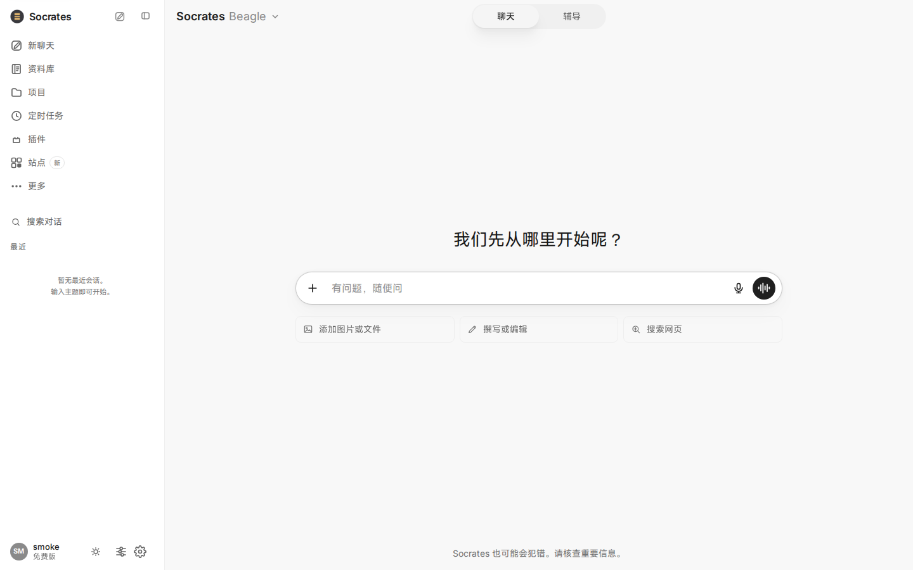
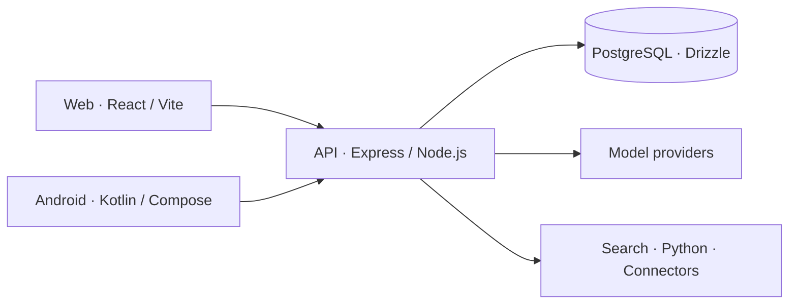

<div align="center">

# Socrates

**Understanding begins with a question.**

An AI learning workspace built for curiosity, reasoning, and lasting understanding.

[Explore the app](https://app.topodrive.top/) &nbsp;·&nbsp; [Website](https://topodrive.top/) &nbsp;·&nbsp; [简体中文](README.zh.md) &nbsp;·&nbsp; [Documentation](docs/architecture/README.md)

<br />


<sub>Cosmic Cliffs, NGC 3324 · James Webb Space Telescope · Image: NASA, ESA, CSA, and STScI · [Original photograph](https://esawebb.org/images/weic2205a/)</sub>

<br /><br />

[](https://github.com/kevenhu001-cyber/Socrates/actions/workflows/ci.yml)
[](LICENSE)

</div>

---

## Think beyond the answer

A good tutor doesn't just deliver an answer. It helps you understand *why* the answer makes sense, where your reasoning changes, and what to ask next.

**Socrates** brings guided learning and capable AI assistance into one place. Ask questions, explore a concept from another angle, test what you know, and keep the connections worth remembering. Switch to general chat whenever you need a more direct assistant.

The product combines a web app, a native Android client, and an API platform. Its learning features and tools share the same conversation rather than living in separate demos.

## Inside Socrates

| Learn by questioning | Understand as you go | Return to what matters |
| :--- | :--- | :--- |
| Socratic tutor mode, focused learning modes, and guided explanations | Streaming responses, reasoning surfaces, mathematical notation, and interactive learning cards | Knowledge-boundary graph, diagnostics, generated exams, mistake book, and review |

| Work with your material | Give the assistant tools | Keep your work connected |
| :--- | :--- | :--- |
| Upload documents and images; extract text from PDF, DOCX, XLSX, PPTX, EPUB, and RTF | Web research, page fetching, Python execution, and connector-backed tool calls | Projects, scoped memory, searchable sessions, a file library, scheduled tasks, and read-only sharing |

Features vary by mode, configured provider, and deployment.

## A closer look

These are **actual application captures** used for visual-regression reference, not generated product mockups.

<table>
  <tr>
    <td width="50%"></td>
    <td width="50%"></td>
  </tr>
  <tr>
    <td align="center"><sub>Dark theme</sub></td>
    <td align="center"><sub>Light theme</sub></td>
  </tr>
</table>

<details>
<summary>Small-screen capture</summary>

<br />


</details>

## Get started

### Requirements

- Node.js **20.19+**, **22.12+**, or **24+**; npm 10+
- PostgreSQL 16; pgvector recommended for semantic retrieval
- Optional for Android: JDK 17 and Android SDK 35

The web and API projects have separate lockfiles. Install each explicitly.

```bash
git clone https://github.com/kevenhu001-cyber/Socrates.git
cd Socrates

npm ci
npm --prefix server ci
npm --prefix frontend ci
```

Create a database, then configure and start the API:

```bash
createdb socrates
cp server/.env.example server/.env

# Set DATABASE_URL in server/.env.
# Set SESSION_SECRET before any production deployment.

cd server
npm run db:migrate
npm run dev
# API: http://localhost:8080
```

In a second terminal:

```bash
cd frontend
API_PORT=8080 npm run dev
# Web: http://localhost:5173
```

The Vite development server can use a local API stub when the server is unavailable. For a complete local setup, connect to the running API.

**Android:** See [the native client guide](apps/socrates-android/README.md) for SDK requirements, API configuration, and feature parity.

## How it fits together



Socrates uses SSE for streaming chat. The server prepares each turn, orchestrates model and tool calls, persists the conversation, and exposes replayable turn events to recover from a dropped connection.

| Area | Main technologies |
| :--- | :--- |
| Web | React 19, TypeScript, Vite, Zustand, TipTap, KaTeX |
| API | Node.js, Express 5, TypeScript |
| Data | PostgreSQL, Drizzle ORM, optional pgvector retrieval |
| Android | Kotlin, Jetpack Compose |
| Shared code | `@socrates/core`, `@socrates/contracts`, `@socrates/theme`, `@socrates/ui` |
| Additional tooling | Rust crates, Playwright, GitHub Actions |

### Repository guide

```text
frontend/                Web application
server/                  API, services, database migrations
apps/socrates-android/   Native Android client
packages/                Shared contracts, core, theme, UI
prompts/                 Teaching and learning modes
site/                    Product website
docs/                    Architecture, API, decisions, operations
tools-rust/              Native and WASM helpers
```

## Working on the project

```bash
npm run typecheck
npm run lint
npm run verify
npm run test:fast
```

For focused checks, use `npm --prefix frontend run test:unit`, `npm --prefix frontend run test:e2e:smoke`, or `npm --prefix server run test`.

Changes to protocol contracts, database schema, rendering, or sandbox execution should follow the ownership rules in [AGENTS.md](AGENTS.md). The current architecture description lives in [docs/architecture/](docs/architecture/README.md); dated plans and audits are historical context rather than live specifications.

**Technical references:** [Architecture](docs/architecture/mental-model.md) · [OpenAPI](docs/api/openapi.yaml) · [Operations runbook](docs/ops/runbook.md) · [Architecture decisions](docs/adr/README.md)

## Deployment and security

Production deployment is documented in [the operations runbook](docs/ops/runbook.md) and driven by [`deploy.sh`](deploy.sh). The deployment uses nginx for the web client and reverse proxy, with a systemd-managed API process.

Sessions use server-side expiry; provider credentials are encrypted at rest; state-changing requests have CSRF protection. Model-authored visualizations and Python execution run within separately constrained execution paths. These controls should not be treated as a blanket guarantee for untrusted workloads; review the deployment configuration before exposing a public instance.

## License and credits

Socrates is **source-available, not OSI-approved open source**. Non-commercial use is permitted under the conditions in [LICENSE](LICENSE); commercial use requires separate authorization. Third-party dependencies and media retain their own terms.

Cover photograph: *Cosmic Cliffs* by the James Webb Space Telescope — **Image: NASA, ESA, CSA, and STScI**, sourced from [ESA/Webb](https://esawebb.org/images/weic2205a/) under its [image reuse policy](https://esawebb.org/copyright/). Image is presented without artistic modification. The real spacecraft photograph used by the product website is credited separately to **NASA/JSC, ISS022-E-062673**.

<sub>Socrates is an independent project; NASA, ESA, CSA, and STScI do not endorse it.</sub>
