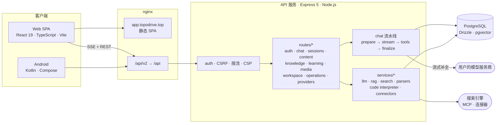
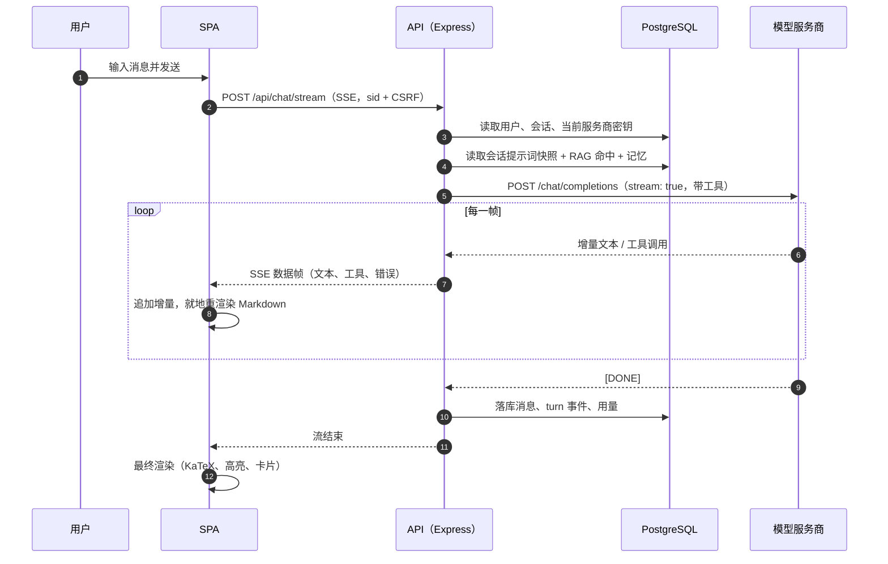

<div align="center">


<br/>

[](https://github.com/kevenhu001-cyber/Socrates/actions/workflows/ci.yml)
[](frontend/)
[](server/)
[](apps/socrates-android/)
[](#许可)

**Socrates —— 为「想真正弄懂」的人准备的 AI 导师。**

Socrates 是一个全栈学习工作台：苏格拉底式教师提示词、带推理模型的流式对话、学习卡片、知识边界图谱、
诊断评估、考试与错题本，和文档解析、联网检索、Python 沙箱、连接器工具共用同一个对话界面，
并配有一个独立的原生 Android 客户端。

[English](README.md) · [在线应用](https://app.topodrive.top/) · [官网](https://topodrive.top/) · [OpenAPI 规范](docs/api/openapi.yaml) · [架构导览](docs/architecture/mental-model.md)

</div>

---

## 目录

- [Socrates 是什么](#socrates-是什么)
- [界面截图](#界面截图)
- [能力概览](#能力概览)
- [架构](#架构)
- [技术栈](#技术栈)
- [仓库结构](#仓库结构)
- [快速开始](#快速开始)
- [配置](#配置)
- [质量门禁](#质量门禁)
- [持续集成](#持续集成)
- [部署](#部署)
- [安全模型](#安全模型)
- [文档地图](#文档地图)
- [参与贡献](#参与贡献)
- [许可](#许可)
- [支持](#支持)

---

## Socrates 是什么

大多数 AI 对话产品是一个输入框加一条聊天记录。Socrates 的出发点不同：
**理解来自提问，而不是来自答案。** 仓库内置的 [`prompts/teacher-mode.md`](prompts/teacher-mode.md)
把模型设定为一位有耐心的老师——先举例子再讲概念，用提问代替断言，用「换个角度想想」代替「你错了」：

> 就像一位耐心温和的老师在跟你聊天。平时正常对话，不刻意教东西。
>
> - 对方问问题或遇到困难时，再拿出老师的引导感
> - 对方只是闲聊（比如打招呼），正常回应就好
> - 讲东西时先举例子再讲概念，用"换个角度想想"代替"你错了"
> - 偶尔用引导式提问代替直接给答案

仓库里的其他部分，都是为了让这件事在日常使用中站得住：在模型还没写完时就能正确渲染的传输层、
能跨会话留存的学习记录，以及一个工具在超过三段对话之后必然需要的项目、文件、搜索和分享能力。

产品以**两个第一方客户端**对接同一套 API：Vite/React 的 Web 单页应用，以及独立的 Kotlin/Compose
Android 应用。两者都走 `/api/v2`（由 nginx 重写到服务端的 `/api`），并通过 `packages/contracts`
与 `packages/core` 共享协议与会话类型。

## 界面截图

下面是视觉回归测试用作基准的实拍截图（`docs/assets/parity-2026-10-19/`），不是宣传渲染图。
界面中英双语，中文截图对应默认语言。

<div align="center">

| 首页 · 深色 | 首页 · 浅色 |
| --- | --- |
|  |  |

| 窄屏 · 英文 | |
| --- | --- |
|  | |

</div>

## 能力概览

### 教与学

- **辅导模式。** 输入框上的模式切换会换上教师提示词与教学流水线；普通对话模式则保持通用助手行为。
  两种模式共用同一份对话记录，一段对话可以在「讲解」和「追问」之间来回切换。
- **学习模式。** `prompts/learning-modes.md` 在服务端定义每种模式（聚焦、练习、复习……）的行为。
  客户端只发送模式 id，教学策略留在服务端，并且只对当前这一轮生效。
- **学习卡片。** 模型用 `{version:1,nodes:[...]}` 类型化信封作答，客户端渲染成原生组件——步骤、折叠面板、
  图片、徽标、演示动画，而不是一段 HTML。契约表达不了的内容会降级为正文。
- **知识边界图谱。** 用确定性的力导向布局画出学习者「已内化 / 模糊 / 未接触」的知识节点，附置信度、
  笔记与变更历史。
- **诊断与考试。** 诊断流程负责出题、按规则评分、给出洞察并可重跑；考试同样生成、服务端持久化、
  作答与讲评。
- **错题本与复习。** 错题按会话和跨会话收集，支持分组练习，并通过间隔重复的复习卡组和问题链重新出现。

### 对话

- **SSE 流式对话**，配一套专门写的渐进式 Markdown 渲染器：标题、列表、代码围栏、引用和行内强调
  在语法闭合的瞬间就出现；收尾时同一份 DOM 再升级为 KaTeX 公式、语法高亮和可交互卡片。
- **推理模型。** ` thinking…</think>` 流式进入可折叠卡片，思考前后的正文依然按实时 HTML 渲染。
- **消息级操作**——复制、编辑、删除、重新生成、分支、换角度重讲、反馈——以及会话内查找
  （`Ctrl/⌘-F`）、全局搜索（`Ctrl/⌘-K`）、斜杠命令面板、提示词模板和快捷键速查。
- **附件。** 图片与音频作为多模态内容发送；PDF、DOCX、XLSX、PPTX、EPUB、RTF 在服务端解析成文本后
  才进入上下文。
- **单轮内的工具调用。** 联网搜索（MiniMax、Bing、SearXNG、Firecrawl 统一接口）、网页抓取、
  Python 执行、图片搜索、记忆写入、连接器调用、站点生成和可视化渲染，都走同一条工具循环，
  并呈现为可展开的工具卡片。

### 工作台

- **项目**支持项目级指令和记忆范围（`default` 或 `project-only`），项目对话读不到不该读的个人记忆。
- **资料库与创作。** 上传的文件、生成的产物、发布的页面有统一的浏览入口，支持搜索、元信息、
  重命名、删除与「附加到对话」。
- **插件与连接器。** MCP 服务器、OOMOL 托管的 OpenConnector 应用、项目级连接器按账号安装，
  并作为工具提供给模型。
- **定时任务与后台运行。** 类 cron 的定时任务、可恢复的 workspace agent 运行、研究任务在关闭标签页后
  继续执行，带租约、可重放事件和产物。
- **分享。** 只读会话链接与公开站点（`/s/:token`），复用同一套 transcript 渲染器并强制只读。
- **用量与密钥。** 按用户统计 token、用量看板，以及自带密钥（BYOK）的服务商配置。

## 架构

仓库是多个独立 npm 项目组成的 monorepo（不做 workspace 提升）：一个 SPA、一个 API 服务、
四个共享包、一个 Android 应用、一个静态官网，以及一组 Rust crate。



**服务端边界。** `routes/<domain>/` 只负责 HTTP 关注点（认证、作用域、校验、状态码）；
`services/<domain>/` 负责可复用的领域逻辑，且不得反向依赖 HTTP 组合层；`lib/` 放中性原语。
`routes/chat/prepare/` 组装一次请求（wire schema、提示词快照、RAG、记忆、工具目录、限额），
`routes/chat/pipeline/` 执行且只执行一轮流式对话（工具循环、SSE 帧、收尾）。
这条边界由 `server/scripts/check-service-boundaries.mjs` 强制。

**客户端边界。** `frontend/src/chat/`（传输、会话、流式）不得导入 `frontend/src/react/`，
唯一允许的共享契约是 `frontend/src/react/types/`。React 通过 `frontend/src/store/` 的类型化 hooks
读写状态，而不是 window 全局。共享展示组件放在 `packages/ui/`，是普通 React DOM 组件，按窄子路径挂载；
`packages/*` 必须保持 DOM-free，由 [`scripts/check-packages-dom.mjs`](scripts/check-packages-dom.mjs) 校验。

### 一次对话的完整链路



实时 SSE 请求是唯一主链路。`/api/chat-turns` 的作用是：刷新页面或连接中断后，重放仍在运行的这一轮事件——
它是恢复通道，不是第二种传输方式。每一轮在准备阶段之前就以原子方式领取，重复提交会收到带重连 id 的
`CONFLICT`，而不是把工具执行两遍。

### 流式渲染器

两个渲染器共用一个模块 [`frontend/src/render/markdown.ts`](frontend/src/render/markdown.ts)：

| 渲染器 | 使用时机 | 行为 |
| --- | --- | --- |
| `formatMsgProgressive` | 流式期间每个动画帧 | 逐行状态机；语法一闭合就输出标题、列表、代码围栏、引用与行内强调 |
| `formatMsg` | 本轮结束、重新打开历史、复制导出 | 完整流水线：`marked` + KaTeX + highlight.js + 可视化/卡片挂载 |

模型泄漏的对话模板标记（`<|im_start|>`、`[INST]…[/INST]`）每帧剥离一次，不会在屏幕上闪一下；
转义使用 nonce 占位符，而不是「先转义再还原」——后者在消息本身就包含 `<code>` 时会出错。

## 技术栈

| 层 | 技术 | 说明 |
| --- | --- | --- |
| Web 客户端 | React 19、TypeScript、Vite | [`frontend/`](frontend/)；静态外壳通过唯一的 root 注册表挂载 React 岛 |
| 客户端状态 | Zustand 读取器 + 不可变 bridge | [`frontend/src/store/`](frontend/src/store/) |
| 富文本 | TipTap 3 | 仅用于输入框；正文仍是服务端渲染的 HTML |
| 可视化 | tldraw 5.5、Three.js、Mermaid、ECharts、Plotly、MapLibre | 懒加载，Web 专属岛 |
| 公式与代码 | KaTeX、highlight.js | UMD 内置在 `frontend/src/vendor-files/`，无 CDN 回退 |
| Markdown | `marked` 13 + 自研渐进渲染器 | 见[流式渲染器](#流式渲染器) |
| API | Node.js 20.19+/22.12+/24+、Express 5、TypeScript | [`server/`](server/) |
| 数据 | PostgreSQL 16 + pgvector、Drizzle ORM 0.45 | CI 与 OCI 镜像使用 `pgvector/pgvector:pg16`；迁移在 [`server/drizzle/`](server/drizzle/) |
| 检索 | BM25 分块 + 可选 pgvector 重排、embedding 服务 | 未配置 embedding 时自动降级 |
| Python 沙箱 | Pyodide + 有界 worker 池 | [`server/src/services/codeInterpreter/`](server/src/services/codeInterpreter/) |
| 工作区 Agent | Bubblewrap 中的 `pi` 编码代理 | 文件系统/PID 隔离，不是完整的执行节点策略 |
| 可观测性 | OpenTelemetry 追踪与指标（OTLP/HTTP） | 未设置 `OTEL_EXPORTER_OTLP_ENDPOINT` 时完全不加载 SDK |
| 共享包 | `@socrates/core`、`@socrates/contracts`、`@socrates/theme`、`@socrates/ui` | [`packages/`](packages/)，DOM-free，按路径链接 |
| Android | Kotlin、Jetpack Compose、Gradle | [`apps/socrates-android/`](apps/socrates-android/) |
| 原生辅助 | Rust crate：protocol、format、stream、fetch、wasm | [`tools-rust/`](tools-rust/) |
| 官网 | 静态 HTML/CSS/JS，自带 Node 测试 | [`site/`](site/) |
| CI | GitHub Actions：CI 门禁、服务端、安全、OCI 镜像、Android、Agent 工具链 | [`.github/workflows/`](.github/workflows/) |
| 边缘 | nginx：静态 SPA + `/api/v2` 反向代理 + CSP include | [`ops/nginx/`](ops/nginx/) |

## 仓库结构

```text
Socrates/
├── frontend/                 Vite SPA —— 唯一的生产 Web 客户端
│   ├── index.html            静态外壳、挂载宿主、CSP 哈希
│   ├── src/
│   │   ├── main.ts           启动组合（batchStorage.ts 必须最先导入）
│   │   ├── app/ auth/        启动、认证门、旧接口桥
│   │   ├── chat/             传输、turn、流式、发送流水线
│   │   ├── session/          历史、分页、持久化
│   │   ├── render/           渐进 + 完整 Markdown 渲染器
│   │   ├── tutor/ exam/      教学流程、诊断、考试
│   │   ├── react/            React 表面（岛与页面）
│   │   ├── store/            类型化状态工厂与 hooks
│   │   ├── styles/           唯一样式入口，级联顺序固定
│   │   └── vendor-files/     内置 UMD 库
│   ├── e2e/                  Playwright 套件（smoke/regression/theme/visual）
│   ├── test/                 Node 单元测试
│   └── dev-stub/             `vite dev` 使用的本地 API stub
├── server/                   Express API
│   ├── src/
│   │   ├── index.runtime.ts  运行时入口（index.js 是 systemd 兼容壳）
│   │   ├── app.ts            中间件顺序与路由挂载
│   │   ├── boot/             启动与生命周期阶段
│   │   ├── routes/           auth、chat、sessions、content、knowledge、
│   │   │                     learning、media、workspace、operations、providers
│   │   ├── services/         llm、rag、search、parsers、sandbox、connectors
│   │   ├── db/               Drizzle schema 与客户端
│   │   └── lib/              中性原语
│   ├── drizzle/              SQL 迁移与元数据
│   └── test/                 逐文件测试套件
├── packages/
│   ├── core/                 SSE 分帧、turn 运行时、学习/考试模型
│   ├── contracts/            跨客户端协议类型
│   ├── theme/                Web 与原生共用的设计 token
│   └── ui/                   共享 React DOM 组件（窄子路径）
├── apps/socrates-android/    独立 Kotlin + Compose 客户端
├── site/                     官网（中英）、测试、OpenAPI 导出
├── tools-rust/               Rust crate 与 WASM 构建
├── prompts/                  教师模式、学习模式、服务商提示词
├── docs/
│   ├── architecture/         当前系统说明 —— 从这里开始
│   ├── adr/                  架构决策记录
│   ├── api/openapi.yaml      HTTP 契约（OpenAPI 3.1）
│   ├── audits/               带日期、不再修改的审计快照
│   ├── plans/                带日期的计划与交接
│   ├── ref/                  参考基线截图与度量手册
│   ├── ops/runbook.md        运维手册
│   └── STRUCTURE.md          新文档该放哪里
├── scripts/                  守卫、生成器、CI 工具
├── ops/nginx/                CSP 片段、代理示例、性能配置
├── tasks/                    活跃任务清单 + 冻结的历史证据
├── test/                     根级测试（官网、OpenAPI、受影响测试映射）
├── chat-demo/                上游 DeepSeek 客户端，只读参考
├── deploy.sh                 生产发布脚本
├── AGENTS.md                 给 Agent 与贡献者的工程规则
└── README.md / README.zh.md
```

## 快速开始

### 环境要求

- **Node.js** `^20.19`、`^22.12` 或 `>=24`（服务端声明的范围；Volta 固定 22.23.1）
- **PostgreSQL 16** 与 `vector` 扩展（CI 与 OCI 镜像使用的版本），用于语义检索
- **npm 10+**
- 可选：Rust 工具链（`tools-rust/`）、JDK 17 + Android SDK 35（Android 客户端）

### 1. 克隆并安装

每个项目有自己的 lockfile，需要分别安装：

```bash
git clone https://github.com/kevenhu001-cyber/Socrates.git
cd Socrates

npm ci                    # 根工具链：prettier、yaml、playwright
npm --prefix server ci
npm --prefix frontend ci
```

### 2. 数据库

```bash
createdb socrates
```

迁移会创建表结构。迁移 `0031` 在扩展可用时安装 pgvector，不可用则跳过向量列——检索自动退回
BM25，而不是直接失败。

### 3. API 服务

```bash
cd server
cp .env.example .env      # 至少设置 DATABASE_URL 与 SESSION_SECRET
npm run db:migrate
npm run dev               # http://localhost:8080
```

`NODE_ENV=production` 时 `SESSION_SECRET` 是必填项（用于加密存储的服务商密钥）；本地开发会回退到
开发密钥。`server/.env.example` 按功能分组列出了进程读取的全部变量。

### 4. Web 客户端

```bash
cd frontend
API_PORT=8080 npm run dev    # http://localhost:5173
```

Vite 代理默认指向 `3037`：要么让它指向服务端（`API_PORT=8080`），要么让服务端跑在 `3037`
（`PORT=3037 npm start`）。没有 API 监听时，开发服务器会用 `frontend/dev-stub/` 里的 stub 应答，
让外壳和输入框仍可用；`LOCAL_AUTH_BYPASS=0 npm run dev` 可关闭这条路径。

生产构建：

```bash
cd frontend
npm run build                # → frontend/dist/
```

### 5. Android 客户端（可选）

```bash
cd apps/socrates-android
./gradlew assembleDebug testDebugUnitTest lintDebug
```

需要 JDK 17 与 Android SDK 35 / Build Tools 35.0.0；用 `ANDROID_HOME` 或被忽略的 `local.properties`
指向 SDK。API 地址配置、网络安全策略与当前功能对齐情况见
[`apps/socrates-android/README.md`](apps/socrates-android/README.md)。

## 配置

服务端完全通过环境变量配置；SPA 的设置存在浏览器里，不从磁盘读配置。

| 变量 | 必填 | 默认 | 作用 |
| --- | --- | --- | --- |
| `DATABASE_URL` | 是 | — | PostgreSQL 连接串 |
| `SESSION_SECRET` | 生产必填 | 开发回退值 | HKDF 种子，用于加密存储的服务商凭据 |
| `PORT` | 否 | `8080` | HTTP 监听端口 |
| `NODE_ENV` | 否 | `development` | `production` 启用密钥必填、安全 Cookie 与更安静的日志 |
| `APP_URL` / `CORS_ALLOWED_HOSTS` | 否 | — | 公开源站与允许的跨域主机 |
| `BEAGLE_SYSTEM_KEY` | 否 | — | 预置内置「Beagle」服务商，让新装环境无需用户密钥即可使用 |
| `OOMOL_PROJECT_API_KEY` | 否 | — | 应用集成使用的 OOMOL 托管连接器运行时 |
| `SMTP_*` | 否 | — | 验证邮件与密码重置 |
| `OTEL_EXPORTER_OTLP_ENDPOINT` | 否 | — | 打开追踪；不设置则完全不加载 SDK |
| `INTERNAL_METRICS_TOKEN` | 否 | — | 以 Bearer 令牌启用 `GET /api/_internal/metrics` |
| `SCHEDULER_ENABLED` | 否 | 开启 | `0` 关闭定时任务的自动轮询 |
| `PI_AGENT_ENABLED` / `PI_AGENT_ISOLATION` | 否 | 开启 / `bubblewrap` | 工作区 Agent 开关与隔离模式 |
| `EXEC_*` | 否 | 见模板 | Python 沙箱限额：池大小、超时、输出与产物上限 |

`server/.env.example` 是权威清单（当前 114 个变量），按核心服务、对话、工作区 Agent、沙箱、
连接器、邮件、管理、可观测性和 Android 分组。

## 质量门禁

在这个仓库里，「做完」意味着对应的门禁通过。它们单独跑很便宜、全量跑很贵，所以工具链是按
「针对性验证」设计的。

```bash
npm run lint          # 前端 lint 链 + 服务端边界 + drizzle、文档、
                      # shim、里程碑标记、格式、core 声明、Action 固定
npm run typecheck     # 服务端 + 前端
npm run verify        # typecheck + lint + 共享包测试
npm run test:fast     # 只跑与本次改动相关的测试
```

`npm run lint` 不只是 `tsc` 加 ESLint。它最后串着约三十个棘轮，冻结一项债务计数且只允许下降：
裸 `<button>`、不在尺寸梯级上的控件高度、字面量 `z-index`、活跃 CSS 里的 `!important` 与十六进制颜色、
冻结 CSS 里的死规则、显式 `any`、空 `catch`、转发 shim、未类型化的前端 JS、孤儿模块、泄漏的外部主机、
未固定 SHA 的 GitHub Action、CSP 漂移、OpenAPI 漂移、Drizzle 快照漂移等等。完整表格与每个守卫保护的
问题在 [`AGENTS.md`](AGENTS.md)。

按需运行的测试：

| 命令 | 范围 |
| --- | --- |
| `npm --prefix frontend run test:unit` | 前端单元测试（Node test runner + `tsx`） |
| `npm --prefix server run test` | 每个测试文件一个进程；无数据库时跳过 DB 套件 |
| `npm --prefix server run test:db:memory` | PGlite + 真实迁移 + pgvector，无需 PostgreSQL 服务 |
| `npm --prefix frontend run test:e2e:smoke` | Playwright smoke 层 |
| `npm --prefix frontend run test:e2e:required` | smoke + regression + theme（阻塞集） |
| `npm --prefix frontend run test:e2e:visual` | 截图/几何基线（提示性） |
| `npm run test:site` | 官网布局、内容、字体、动效、OpenAPI 导出 |
| `npm run test:openapi` | 已发布的 OpenAPI 文档 |

服务端测试拒绝在数据库名不含独立 `test` / `qa` 片段的库上运行；`TEST_DATABASE_URL` 优先于 `.env`。

## 持续集成

| 工作流 | 触发 | 验证内容 |
| --- | --- | --- |
| [`ci.yml`](.github/workflows/ci.yml) | push、PR | 变更分类 → 仓库体检、官网、前端（lint、构建、包体预算、单测、必需 e2e）、服务端、共享包 + Rust 协议；最后由 `gate` 汇总 |
| [`server-ci.yml`](.github/workflows/server-ci.yml) | server 路径 | 针对真实 PostgreSQL 的完整服务端套件、边界与 lint 检查 |
| [`security.yml`](.github/workflows/security.yml) | push、PR、每周 | CodeQL、依赖审计（对照只减不增的基线）、SBOM |
| [`image.yml`](.github/workflows/image.yml) | server 路径 | 构建并校验签名的 API OCI 镜像；**不负责部署** |
| [`native-android-build.yml`](.github/workflows/native-android-build.yml) | Android 路径 | `assembleDebug`、单元测试、lint、调试 APK 产物 |
| [`agent-tooling-ci.yml`](.github/workflows/agent-tooling-ci.yml) | 工具调用相关路径 | 服务端工具链与前端 Agent UI 检查 |

覆盖率按项目各自统计自己的 `src/**`，在 PR 上是提示、在 `main` 上是阻塞项。主题与对比度用例阻塞，
截图与几何基线用例仅作提示。

## 部署

生产环境是一台 nginx 主机加一个 systemd 单元（`socrates-api`）。[`deploy.sh`](deploy.sh) 是唯一
受支持的发布路径：

```bash
./deploy.sh                 # SPA 构建 + 后端构建 + 迁移 + 重启 + 门禁
./deploy.sh --site-only     # 只发布 site/，不构建、不迁移、不重启
./deploy.sh --require-ci    # 额外要求 GitHub Actions 为绿
```

完整发布会安装锁定版本的依赖、把 SPA 构建进 Web 根目录、把服务端编译到隔离的候选目录并在构建成功后
才换入（保留 `dist.previous/`）、执行迁移、重启服务，然后校验：前端文档校验和、本机 `/api/health`、
状态页字节与公网 DNS 路径。若重启或健康门禁失败，会自动恢复上一版后端构建并以非零状态退出。
发布用 `flock` 串行化，第二个调用会立即退出。

CI 合并门禁**默认是提示性的**——红灯会被记录进 `.deploy-state.json`，但不阻塞发布；加上
`--require-ci` 或 `DEPLOY_REQUIRE_CI_CHECK=1` 才变成强制。应用代码回滚**不会**回滚数据库迁移；
备份、隔离恢复演练和精确的手工回滚命令见 [`docs/ops/runbook.md`](docs/ops/runbook.md)。

服务端除 PostgreSQL 外无状态，水平扩展就是在同一 nginx 后面多跑几个进程。`image.yml` 已经在每次
推送时构建 OCI 镜像；把部署改成拉取该镜像摘要，而不是在主机上构建，是一项单独且被有意推迟的变更。

## 安全模型

- **认证。** bcrypt 存储密码哈希；64 字符会话令牌放在 `HttpOnly`、`SameSite=Lax` 的 `sid` Cookie 里，
  过期由服务端强制。登录按账号与 IP 限流并锁定。
- **CSRF。** 双提交 Cookie：SPA 把 `csrf` Cookie 回填到 `X-CSRF-Token`，不匹配的写请求直接拒绝。
- **服务商密钥。** 用 `SESSION_SECRET` 派生的密钥加密存储；浏览器只拿到掩码预览，代理仅在单次请求
  期间持有明文。
- **内容安全策略。** 同一份生成源同时产出 Express 响应头与 nginx 片段，包含 `index.html` 中两段
  预渲染内联脚本的 `sha256` 哈希；任一处漂移都会让前端 lint 失败。`script-src` 有意保留
  `'unsafe-inline'`：可视化卡片是模型生成的内联脚本文档，运行在 `srcdoc` iframe 中并继承父页面策略，
  只给哈希会让所有可交互可视化失效。哈希仍然照常生成，等这些文档改由真实同源 URL 提供后即可收紧。
- **沙箱渲染。** 模型生成的 HTML/SVG 在 `sandbox="allow-scripts"` 且不带 `allow-same-origin` 的
  iframe 中运行，碰不到父页面 DOM 和用户 Cookie。
- **上传。** 非图片文件一律 `Content-Disposition: attachment`；HTML/XHTML 在 multer 层就被拒绝。
- **代码执行。** Python 跑在 Pyodide worker 里，有单次超时、输出与产物上限、临时目录 TTL 和可选的
  CJK 字体包；不涉及宿主机 Python 进程。
- **工作区 Agent。** `pi` 在 Bubblewrap 中运行，只有本轮工作区可写；宿主机 home、应用密钥和其他工作区
  都被隐藏。隔离失败会拒绝运行，而不是退回宿主机执行。这是文件系统/PID 隔离，不是完整的多租户执行
  策略——网络出口和 cgroup 配额属于宿主机责任。
- **运维接口。** 未设置 `INTERNAL_METRICS_TOKEN` 时 `GET /api/_internal/metrics` 直接 404；设置后需
  Bearer 令牌，且抓取不计入业务指标。

## 文档地图

`docs/` 明确区分**当前规范**与**历史记录**。左列可以当事实读，右列只提供来龙去脉。

| 路径 | 是什么 | 可以信什么 |
| --- | --- | --- |
| [`docs/architecture/mental-model.md`](docs/architecture/mental-model.md) | 组合根、一次对话、状态归属、服务端边界 | 系统今天如何工作——从这里开始 |
| [`docs/architecture/README.md`](docs/architecture/README.md) | 索引与阅读规则 | 该信哪份文档 |
| [`docs/architecture/naming.md`](docs/architecture/naming.md) | 文件与类型命名规则 | 新模块该放哪 |
| [`docs/architecture/ui-structure.md`](docs/architecture/ui-structure.md) | 前端架构详解 | UI 生命周期、样式归属、迁移债务 |
| [`docs/adr/`](docs/adr/README.md) | 架构决策记录 | 为什么这样决策，以及否决了什么 |
| [`docs/api/openapi.yaml`](docs/api/openapi.yaml) | OpenAPI 3.1 契约 | Web、Android 与服务端共享的请求/响应形状 |
| [`docs/audits/`](docs/audits/README.md) | 带日期的审计快照 | 只作历史——其中多份描述的目录已不存在 |
| [`docs/plans/`](docs/plans/) | 带日期的计划与交接 | 意图与顺序，不是当前行为 |
| [`docs/ref/`](docs/ref/) | 参考截图与度量手册 | 它记录的那次测量，及其日期 |
| [`docs/ops/runbook.md`](docs/ops/runbook.md) | 发布、回滚、备份与恢复 | 如何操作生产主机 |
| [`docs/STRUCTURE.md`](docs/STRUCTURE.md) | 新文档该放哪里 | 文档落点约定 |
| [`AGENTS.md`](AGENTS.md) | 归属地图、风险面、守卫表、测试规则 | 工程契约 |

## 参与贡献

目前不接受核心团队之外的 PR。缺陷报告与功能请求欢迎发到
[help@addtech.site](mailto:help@addtech.site)。

有写权限的贡献者：

1. 从 `main` 拉分支（`git checkout -b pX.Y/short-name`）。
2. 控制改动范围，补针对性的回归覆盖——不要跑全量套件。
3. 用最小相关门禁验证：`npm run test:fast`、单个 `test:one` 文件，或单个 Playwright spec。
   推送前跑 `npm run lint`。
4. 提 PR，squash 合并。

改动 `frontend/src/main.ts`、`server/src/app.ts`、认证、迁移或 `deploy.sh` 之前，请先读
[`AGENTS.md`](AGENTS.md)：那里列了高变更面、棘轮守卫和每个区域要求的验证方式。

## 许可

本仓库中由版权所有者拥有或有权授权的代码，采用自定义的**源码可见（source-available）**许可，
而非 OSI 认可的开源许可。你可以在非商业用途下免费使用、修改和再分发原始或修改后的受覆盖代码，
前提是保留版权与许可声明；任何商业用途都需要单独授权。第三方组件仍适用其各自的许可。

完整中英双语条款见 [`LICENSE`](LICENSE)，终端用户条款见 [`site/terms.html`](site/terms.html)。
内置的 [`chat-demo/`](chat-demo/README.md) 是 MIT 许可的上游代码，不属于 Socrates 的组成部分。

## 支持

- **产品与账号问题** —— [help@addtech.site](mailto:help@addtech.site) 或应用内「帮助」入口。
- **API 疑问** —— 先读 [`docs/api/openapi.yaml`](docs/api/openapi.yaml)，再看
  [`docs/architecture/mental-model.md`](docs/architecture/mental-model.md) 的服务端边界。
- **Android 构建失败** —— 确认 JDK 17、Android SDK 35 与项目固定的 Gradle 版本；
  `native-android-build.yml` 的日志里有完整堆栈。

<div align="center">

为每一个想弄懂的人，认真做出来。

[English →](README.md)

</div>
