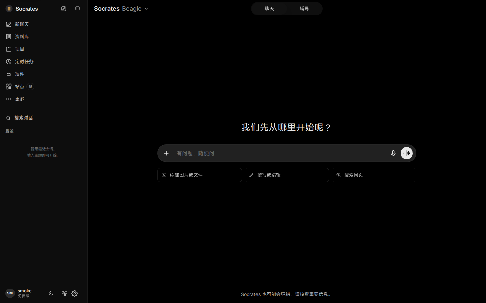
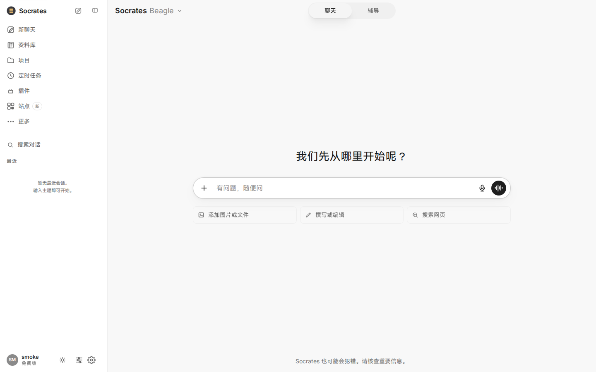
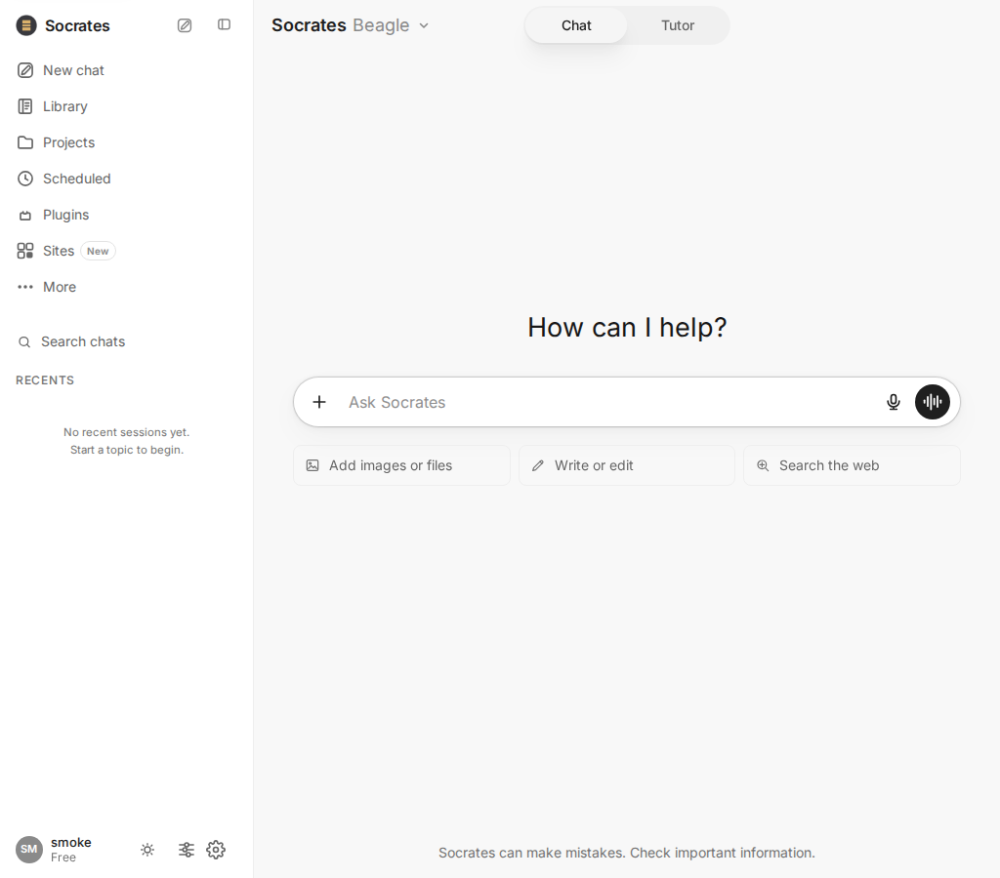
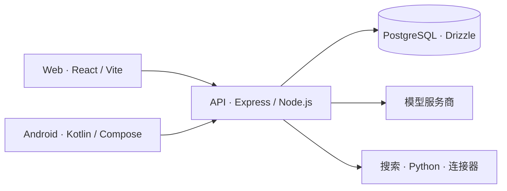

<div align="center">

# Socrates

**理解，始于一个好问题。**

一个为好奇心、思考和真正的理解而设计的 AI 学习工作台。

[开始使用](https://app.topodrive.top/) &nbsp;·&nbsp; [产品官网](https://topodrive.top/) &nbsp;·&nbsp; [English](README.md) &nbsp;·&nbsp; [技术文档](docs/architecture/README.md)

<br />


<sub>奋进号航天飞机与地球大气层 · NASA/JSC · ISS022-E-062673 · 真实航天摄影</sub>

<br /><br />

[](https://github.com/kevenhu001-cyber/Socrates/actions/workflows/ci.yml)
[](LICENSE)

</div>

---

## 不止于得到答案

好的老师不只是告诉你答案，还会帮助你弄明白：**为什么是这样？思路卡在了哪里？下一步该问什么？**

**Socrates** 将引导式学习与通用 AI 助手整合到一个工作台。你可以追问一个概念，换个角度理解同一问题，用测验检验掌握程度，也可以把值得记住的知识联系长期保存下来。不需要教学式引导时，切换到普通对话即可。

项目包含 Web 应用、原生 Android 客户端以及后端 API。对话、学习记录、工具调用和资料管理属于同一套体验，而不是分散的功能演示。

## 核心体验

| 通过提问学习 | 在对话中深入理解 | 把知识留下来 |
| :--- | :--- | :--- |
| 苏格拉底式导师、分场景学习模式、循序渐进的讲解 | 实时流式回答、推理展示、数学公式和交互式学习卡片 | 知识边界图谱、诊断评估、生成考试、错题本与复习 |

| 用自己的资料学习 | 让 AI 使用工具 | 让学习持续发生 |
| :--- | :--- | :--- |
| 上传文档与图片；解析 PDF、DOCX、XLSX、PPTX、EPUB 和 RTF | 联网检索、网页抓取、Python 执行和连接器工具调用 | 项目、分范围记忆、会话搜索、资料库、定时任务及只读分享 |

部分能力取决于对话模式、模型服务商和部署配置。

## 产品界面

以下是**真实应用截图**，同时用于视觉回归测试；不是 AI 生成的产品概念图。

<table>
  <tr>
    <td width="50%"></td>
    <td width="50%"></td>
  </tr>
  <tr>
    <td align="center"><sub>深色模式</sub></td>
    <td align="center"><sub>浅色模式</sub></td>
  </tr>
</table>

<details>
<summary>查看窄屏界面</summary>

<br />



</details>

## 本地启动

### 环境要求

- Node.js **20.19+**、**22.12+** 或 **24+**，npm 10+
- PostgreSQL 16；如需语义检索，推荐安装 pgvector 扩展
- Android 开发另需 JDK 17、Android SDK 35

Web 与 API 分别维护 lockfile，需要各自安装依赖：

```bash
git clone https://github.com/kevenhu001-cyber/Socrates.git
cd Socrates

npm ci
npm --prefix server ci
npm --prefix frontend ci
```

创建数据库，配置并启动后端：

```bash
createdb socrates
cp server/.env.example server/.env

# 在 server/.env 中设置 DATABASE_URL
# 生产部署前必须配置 SESSION_SECRET

cd server
npm run db:migrate
npm run dev
# API：http://localhost:8080
```

另开一个终端启动 Web：

```bash
cd frontend
API_PORT=8080 npm run dev
# Web：http://localhost:5173
```

如果 API 尚未启动，Vite 开发服务器可以使用本地模拟接口；需要完整功能时，请连接真实后端。

**Android 客户端：** 安装、网络配置及功能覆盖情况参见 [原生客户端说明](apps/socrates-android/README.md)。

## 技术架构



Socrates 使用 SSE 实时传输对话。后端负责组装上下文、执行模型与工具调用、持久化会话，并通过可重放的轮次事件支持断线恢复。

| 模块 | 主要技术 |
| :--- | :--- |
| Web | React 19、TypeScript、Vite、Zustand、TipTap、KaTeX |
| API | Node.js、Express 5、TypeScript |
| 数据 | PostgreSQL、Drizzle ORM、可选 pgvector 检索 |
| Android | Kotlin、Jetpack Compose |
| 共享模块 | `@socrates/core`、`@socrates/contracts`、`@socrates/theme`、`@socrates/ui` |
| 辅助工程 | Rust crate、Playwright、GitHub Actions |

### 仓库结构

```text
frontend/                Web 应用
server/                  API、领域服务、数据库迁移
apps/socrates-android/   原生 Android 客户端
packages/                共享协议、核心逻辑、主题与 UI
prompts/                 教学与学习模式
site/                    产品官网
docs/                    架构、API、决策与运维文档
tools-rust/              原生与 WASM 辅助模块
```

## 开发与测试

```bash
npm run typecheck
npm run lint
npm run verify
npm run test:fast
```

按需运行针对性测试：`npm --prefix frontend run test:unit`、`npm --prefix frontend run test:e2e:smoke` 或 `npm --prefix server run test`。

涉及协议、数据库结构、渲染和沙箱的改动，应先阅读 [AGENTS.md](AGENTS.md)。当前架构以 [docs/architecture/](docs/architecture/README.md) 为准；有日期的计划、审计记录仅供历史参考。

**文档入口：** [架构导览](docs/architecture/mental-model.md) · [OpenAPI](docs/api/openapi.yaml) · [运维手册](docs/ops/runbook.md) · [架构决策](docs/adr/README.md)

## 部署与安全

生产部署使用 nginx 托管 Web 与反向代理，并通过 systemd 管理 API；具体步骤见 [运维手册](docs/ops/runbook.md) 和 [`deploy.sh`](deploy.sh)。

会话具有服务端有效期，模型服务商密钥在数据库中加密保存，修改状态的请求受到 CSRF 防护。模型生成的可视化内容与 Python 执行采用分离的受限执行路径。这些措施不代表对所有不可信负载均提供完整隔离；公网部署前仍须审查配置。

## 许可与图片来源

Socrates 采用**自定义源码可见许可，不属于 OSI 认可的开源许可证**。在遵循 [LICENSE](LICENSE) 条款的前提下允许非商业使用，商业用途需要另行授权。第三方代码、图片及素材遵循各自的许可。

封面采用 **NASA/JSC, ISS022-E-062673** 真实航天摄影：国际空间站视角下，奋进号航天飞机与地球大气层的交界景观。图片直接使用仓库中已有的 [NASA 摄影素材](site/media/socrates-nasa-endeavour-limb-v2.jpg)，亦用于[产品官网](https://topodrive.top/)，没有添加虚构星空、霓虹光效或宣传文字。

<sub>Socrates 是独立项目，与 NASA 不存在官方合作或背书关系。</sub>
