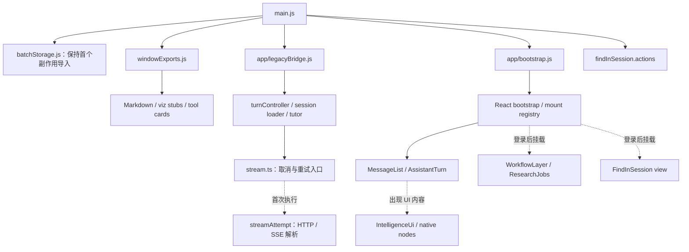

# SPA 首屏依赖审计（2026-10-18）

审计基线为 `4c5d84a8` 的 `frontend/`，本轮仅改 SPA 加载边界和验证工具。没有修改服务端、数据库、部署、Universal App 或 CSS。对 ChatGPT 内部架构、评分和未验证的产品行为不作推断。

## 测量方法与边界

从 `main.js` 的每个静态 import 向下追踪 Rollup 解析后的模块图，同时检查最终输出 chunk 的静态 imports 闭包。两张图必须同时看：barrel 导出可能被 tree-shaking 删除；原本动态的 renderer 也可能因 manualChunks 与静态 helper 同块而进入首屏。

每次 `npm run build` 生成 `frontend/dist/.vite/entry-graph.json`，包含完整解析图、实际保留模块、逐模块静态最短路径、chunk 静态/动态边及 gzip 大小。文件属于生成产物，不提交。模块 `renderedBytes` 是压缩和 minify **之前**的 Rollup 渲染字节，只用于归因，不能当网络收益相加。

```sh
cd frontend
npm run build
npm run audit:entry
npm run audit:entry -- --module=src/chat/streamAttempt.js
```

报告列出 `main.js` 每一个直接 import 的传递保留模块数量和大小。分支共享依赖，数值不可相加。`staticPath: null` 表示不存在从 main 出发的静态模块路径；还须检查所属 chunk 是否在 eager 闭包，才能判定是否离开首屏。

gzip 按资源独立压缩、使用 Node zlib 默认参数，与既有 `performance-loading` 测试一致。这里统计 HTML、静态 JS 闭包、HTML 引用的全部 CSS（含非阻塞 CSS），排除字体、图片、API、运行时动态 import 和 idle 预取，不代表 FCP、LCP 或已登录页面的全部下载量。

基线：静态 JS **373,823 B**（入口 281,453 B、React 70,195 B、Markdown 22,175 B），HTML **18,441 B**，引用 CSS **207,658 B**，合计 **599,922 B gzip**。此前文档中的约 0.95 MB 和更早的 M3 数字不是此 commit 的实测值。

本轮最终构建：静态 JS **359,881 B**、HTML **18,442 B**、引用 CSS **207,658 B**，合计 **585,981 B gzip**。静态 JS 减少 **13,942 B（3.7%）**，上述总量减少 **2.3%**。这不代表已登录总下载量或运行时 CPU 有相同比例提升。

## 实际依赖路径



## 三张清单

### 当前启动契约必须保留在首屏

| main.js 入口组 | 原因 |
| --- | --- |
| `batchStorage.js` | 必须先于其他副作用导入；blocked-storage E2E 固定相对顺序。 |
| `app/errorGuard.js`、`util/api.ts` 的 auth hooks | 首次异步 API 工作前安装错误与认证恢复。 |
| `displayPrefs.js`、`i18n.js`、`config/providers.ts`、`pickers.js` | 主题、语言、模式和模型状态的现有启动契约。 |
| `cookieConsent.js`、`ui/homeSurface.js`、`ui/layoutStateMirror.js` | 当前首页与 shell 可交互所需。 |
| `ui/composerShape.js`、`ui/composerAnim.js`、`ui/keyboard/index.ts`、`ui/topicFocusAssist.js` | 输入区尺寸、键盘和焦点行为。 |
| `ui/scroll.js`、`scrollPill.js`、`pressFeedback.js`、`sidebarResize.js`、`sidebarChrome.js` | 当前 shell 的滚动、反馈和侧栏行为。 |
| `ui/keyboardShortcuts.js`、`composerTools.js`、`effortPicker.js`、`mobileModeSwitch.js`、`sidebar/sidebar.service.ts` | 保留轻量命令与事件注册；命令并不要求导入完整 view。 |
| `app/bootstrap.js` 中的轻量 React 启动与 sidebar nav | 认证前只挂载 sidebar nav；其他表面由现有 auth reveal 路径启动。 |

“当前必须”是现有契约，不等于最终 App Shell 的理想组成。`vendor/init.js` 仍静态安装 marked/DOMPurify；不能在同步 renderer 与 sanitizer 消费者未迁移时只删 import。

### 应当延迟加载，或继续拆分静态边界

| 模块/入口 | 本轮结果或下一步 |
| --- | --- |
| `react/intelligence-ui/IntelligenceUi.tsx` 与 native nodes | **已处理**：普通正文只依赖轻量宿主；文本 fence 或原生 UI tool 出现时才 import。局部 Suspense 保留其他正文，局部 ErrorBoundary 隔离失败。 |
| `react/extensions/WorkflowLayer.tsx` | **已处理**：从静态 registry 依赖改为登录后挂载时 import。仍会在已登录启动时下载，不能称为严格按功能使用加载。 |
| `react/find-in-session/FindInSession.tsx` | **已处理**：main、windowExports、keyboardShortcuts 直接导入已有 action 文件；view 留在 registry 的动态挂载边界。 |
| `chat/streamAttempt.js` 及 SSE 执行依赖 | **已处理**：在 `callAPIStream` 首次执行时 import。加载前安装 AbortSignal 和全局 Stop handle；取消后不发请求，旧 cleanup 不覆盖新 turn。 |
| TipTap、tldraw、Three、设置、考试、workspace pages | 已有动态边界，不重复声称本轮新增。继续检查实际运行时请求。 |
| `app/bootstrap.js` 的 idle vendors | 仍主动预取 highlight、Fuse、KaTeX、考试和 streamingTurn；冷启动静态预算不覆盖它们。移除预取前需补齐 highlight 的按内容加载路径，不能直接删。 |
| `chat/sessionBootstrap.ts`、`app/lifecycle.js`、`tutor/diagnosticFlow.js`、`tutorSocratic.js` | 后续应分离普通聊天、导师诊断与恢复入口。会话初始化和取消顺序需单独回归。 |
| `app/widgetSetup.js`、`render/katexRefresh.ts`、`ui/share.js` | 配置/事件注册与完整渲染依赖仍混合。拆轻量注册与按内容执行，避免制造新的全局 lazy proxy。 |
| `ui/artifactPreview.js`、`ui/linkFavicons.js`、`ui/recentsView.js` | 保留必要监听，继续审计实现侧依赖；不能仅凭文件名认定可以整体移出。 |
| `storage/memoryStore.ts`、`config/tonePresets.ts`、`chat/promptSuffixes.ts`、`chat/liveTurn.ts` | 读配置、装回调与执行代码需区分。当前尚未切断这些分支。 |

### 兼容层退役清单与删除条件

| 待退役边界 | 删除之前必须完成 |
| --- | --- |
| `windowExports.js` | 静态和动态 markup 的 inline handler、运行时代码及测试调用全部迁移为模块命令/受控事件。当前它仍把 Markdown、附件、工具卡、导航等带入入口，不能直接删文件。 |
| `app/legacyBridge.js` / `window.__socratesLegacy` | 逐 domain 迁移调用者。当前 bridge 的转发目标仍在执行发送、会话恢复、工具审批和消息编辑。 |
| `ui/legacyShellListeners.js` | 先确定每个事件唯一 owner，再迁移到主 React 树；防止重复发送或漏键盘操作。 |
| 多个 `createRoot` 与 `window.__socrates*Bridge` | 建立共享主树、portal 与 store 订阅，再迁移 surface 的生命周期。多 Root 数量本身不能证明 scheduler 或性能问题。 |
| Proxy/状态同步路径 | 先统一 turn/session 状态 owner，保留停止、重试、恢复和退出登录的回归，再删除同步桥。 |

本轮没有将兼容层整段删除，也没有实现主 AppRoot。其剩余消费者清理应与 `docs/plans/universal-app-migration.md` 协调，避免在 SPA 与 Universal App 同时建立两套长期新架构。

## 预算与后续优先级

收紧既有 `e2e/performance-loading.spec.mjs`，由 HTML 出发递归计算静态 JS chunk imports，去重后独立压缩，校验与审计报告相同。测试同时禁止本轮移出的四组模块，以及 editor/tldraw/three vendor chunks 回到静态闭包。预算为 HTML <19,000 B、静态 JS <360,000 B、全部引用 CSS <210,000 B、总计 <588,000 B gzip；由现有 CI Playwright gate 执行。

这仍未达到 100–180 KB JS 的 App Shell 目标。下一步应优先拆 turn/session 的 eager graph，再治理登录后 registry 和 idle 下载；CSS 单独按 owner 做迁移，不整体删除兼容目录。

长会话方面，现有 `useProgressiveMessageMount` 在空闲期逐批展开历史，最终仍可挂载全部消息，**不是有界虚拟列表**。同时 `LiveTextSegment` 已有稳定前缀/活动尾部路径；后续增量渲染工作应先测量已有实现的重算范围，不能从零重复建设。虚拟化必须覆盖查找全文、恢复滚动、重试定位、可交互卡片状态和无障碍行为，适合单独交付。

## 验证结果

- 最终生产构建、完整 `npm run lint` 通过。保留既有 ESLint warnings 和大型动态 vendor chunk 提示。
- 定向单元测试覆盖 `entryGraph`、`intelligentUi`、`toolRunSingleSource`、`streamFinalFrame`、`streamThinkOrder`、`streamColdLoad`，共 **27 项通过**。审计 hook 调整后再次单独运行 `entryGraph`，2 项通过。
- 按 diff 运行与定向复跑后，11 组 Playwright 规格共 **47 个独立场景通过**：`performance-loading`、`cold-transport-loading`、`storage-bootstrap`、`find-in-session`、`workflow-layer`、`intelligent-ui-showcase`、`turn-activity`、`chat-send`、`chat-stop-resend`、`streaming-render`、`message-list-compat`。
- 新测试真实阻塞动态 chunk：普通正文不请求 Intelligent UI；等待 UI renderer 时其他正文仍可读，等待期间更新的 tool input 最终显示最新值；等待 transport 时点击 Stop 不发旧请求，后续发送正常。
- 第一轮有两项失败：新预算测试发现审计生成早于 Vite 最后的 preload-map 改写，少算 524 B，现以 `generateBundle` 的 post hook 计量，报告与磁盘字节一致；工作流规格的 `research` 文案断言在独立干净 HEAD `4c5d84a8` 的 4179 端口构建上复现，更新为现有准确英文文案 `Find sources` 后三项工作流规格通过，其余断言不变。
- 已检查加载中/加载完成的桌面截图，输出在 gitignored `frontend/test-results/entry-lazy-ui-{loading,ready}.png`。测试使用本地 production dist 和模拟 API，不能推算真实模型 TTFT 或生产移动设备指标。

没有提交生成产物，没有修改数据库或部署流程，没有发布到生产。
