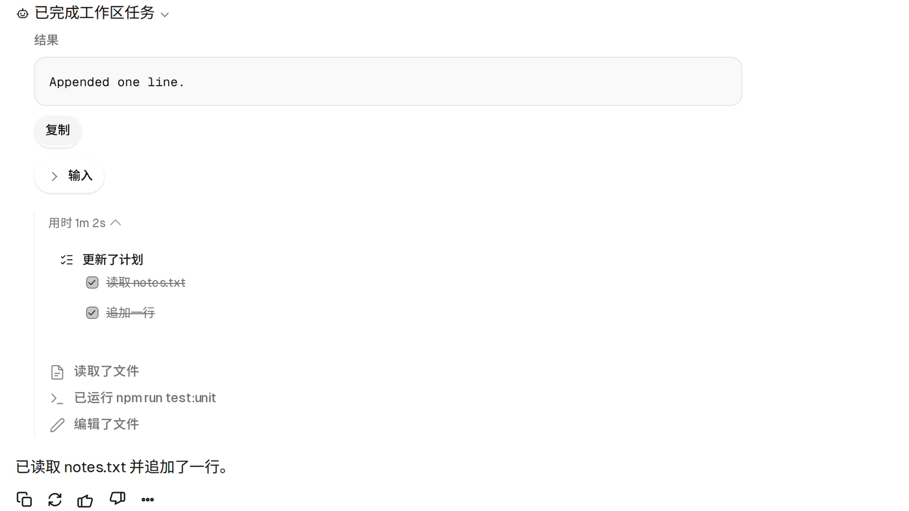
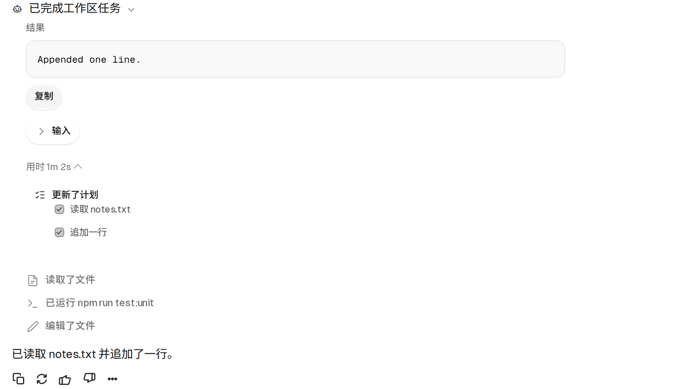

# 活动区去竖线与层级收敛（2026-11-24）

## 背景

工具活动区一直用一条 1px 实线表示「这些步骤属于同一次运行」。2026-11-24 的提示类表面审计把它归入「中性色竖线」，理由是它不承载语气、只做结构分隔。这个判断只看了颜色，没有看结构：线本身没有节点、两端硬切、内容被推开 26–35px，渲染出来更像一条多余的边框，而不是时间线。用户在原话里也直接点名了这根线。

对照两个参照产品，问题更清楚：

- Manus 桌面端也画线，但那是点线，起点是一个 ✓ 圆形节点，步骤 13px，工具缩进成 11–12px 的小 pill。线在表达「先发生什么、后发生什么」。
- Manus 移动端的长回答没有线、没有气泡、没有卡片，层级只靠 600 字重、约 1.5 倍行距和悬挂缩进的编号列表。
- ChatGPT 的活动区默认只有一行「已思考 12s ›」，展开后是纯文本行，也没有线。

共同点不是「不用线」，而是「线只在表示时间顺序时出现，而且一定带节点」。Socrates 的线两者都不满足。

## 改了什么

| 文件 | 改动 |
| --- | --- |
| `packages/ui/src/turn/ThinkingSurface.tsx` | `ThinkingTimeline` 去掉 `borderLeft` 与 `marginLeft`，保留 `paddingLeft` 作为内容缩进 |
| `frontend/src/styles/legacy/15-thinking-activity.css` | `.agent-run` 去线、去 3px 左内边距，整块降到 13/20；摘要去 11px 缩进；步骤间距 2→6px；步骤图标 17→16px；完成态去 `line-through`，回到正常墨色 |
| `frontend/src/styles/features/tool-surfaces.css` | `.tool-run-trigger` 从继承正文的 16/28 降到 13/20，行高 28px，图标与标签间距 8px |
| `frontend/src/styles/features/thinking-activity.css` | favicon 兜底从 14px 裸字母改成 16px 圆角标记：`--ui-radius-xs`、`--ui-bg-panel` 底座、10px 半粗 monogram、大写 |

一共 4 个文件，+42 / −24。没有改信息架构，也没有新增组件。

## 为什么不是「把线调淡一点」

1. **线上没有节点。** 时间线由「点 + 段」成立：点告诉你发生了一件事，段告诉你它们属于同一次运行。一根等宽的线没有点，人眼只会把它读成边框。
2. **两端硬切。** 它没有起点符号，也没有收口；上端悬在「用时」上方，下端停在最后一行下方。任何一条没有端点语义的线，都会被看成「这里没对齐」。
3. **它制造了一条空走廊。** 内容右移 26–35px，行宽变窄；线越淡，走廊越像失误。删掉线之后，同样的缩进立刻显得没有理由——因为理由原本就不存在。
4. **一块区域四种形状。** 线、圆角结果框、pill 按钮、原生 checkbox 同时出现，眼睛找不到「这是一个什么组件」，只能逐个读。

删线之后暴露了下一个问题：摘要、计划头、计划项、步骤出现四个左边缘（486 / 498 / 524 / 486），计划块还留下 20px 死区。这说明线只是把「没有分组」这件事遮住了。真正的收尾是给活动区一个两层结构：默认一行摘要，展开后是一张只有一个左边缘的列表。这一步留在 P1，不在本 PR 里混做。

## 前后对比

| 改前 | 改后 |
| --- | --- |
|  |  |

1440×900，浅色。深色使用同一套规则，只换调色板。

## 量测

| 项目 | 改前 | 改后 |
| --- | --- | --- |
| 活动区左边框 | `1px solid var(--tool-activity-border)` | 无 |
| 活动区左缩进 | 3px 边框 + 11px 内边距（约 26–35px 累计） | 保留 `paddingLeft`，与摘要同一左边缘 |
| 摘要字号 / 行高 | 12.5px / 1.4 | 13px / 20px |
| 步骤字号 / 行高 | 继承正文 16px / 28px | 13px / 20px |
| 工具行 | 16px / 28px，`min-height: 32px` | 13px / 20px，`min-height: 28px` |
| 步骤间距 | 2px | 6px |
| 步骤图标 | 17px | 16px |
| 完成态 | `text-decoration: line-through` | `none`，颜色回到 `--tool-activity-row` |
| favicon 兜底 | 14px 裸字母，白底，无圆角 | 16px 标记，`--ui-radius-xs`，`--ui-bg-panel` 底座，10px 半粗 |

## 没做

- 统一活动区的四个左边缘（P1）。需要把计划块从「卡片」降为「列表」，并让结果行回到同一列。
- 表格容器（P1）：全宽、1px 外框、表头浅底、正文墨色。当前表格只有内容宽、无外框、`td` 是 `#666`。
- 图标收敛（P1）：侧栏仍有 20 / 18 / 16 / 14px 四种尺寸、1.5 / 1.75px 两种描边。
- 深色输入框的内高光（P1）。
- 首页空态入口（P2）。

## 验证

- `cd frontend && npx tsc --noEmit`：通过。
- `cd frontend && npm run build`：通过（本地 `frontend/wasm/` 为 gitignored 占位，CI 会先构建 Rust wasm）。
- `node scripts/check-css-debt.mjs`、`check-font-weight.mjs`、`check-surface-ladder.mjs`、`check-button-sizes.mjs`、`check-mobile-css.mjs`、`check-cjk-punctuation-fonts.mjs`、`check-focus-ring.mjs`：全部通过。
- 手动截图：1440×900 浅色 / 深色，展开态与收起态；本文件的对比图是浅色展开态。
- 未新增 Playwright 视觉基线：这次是删除装饰、调整字号，现有 `visual` 项目会覆盖；如果 reviewer 要求，我可以在合并前补 `frontend/e2e/__screenshots__/` 快照。

## 回滚

本 PR 按仓库约定 squash 合并为一个提交，`git revert -m 1 <squash-sha>` 即可整体回滚。
