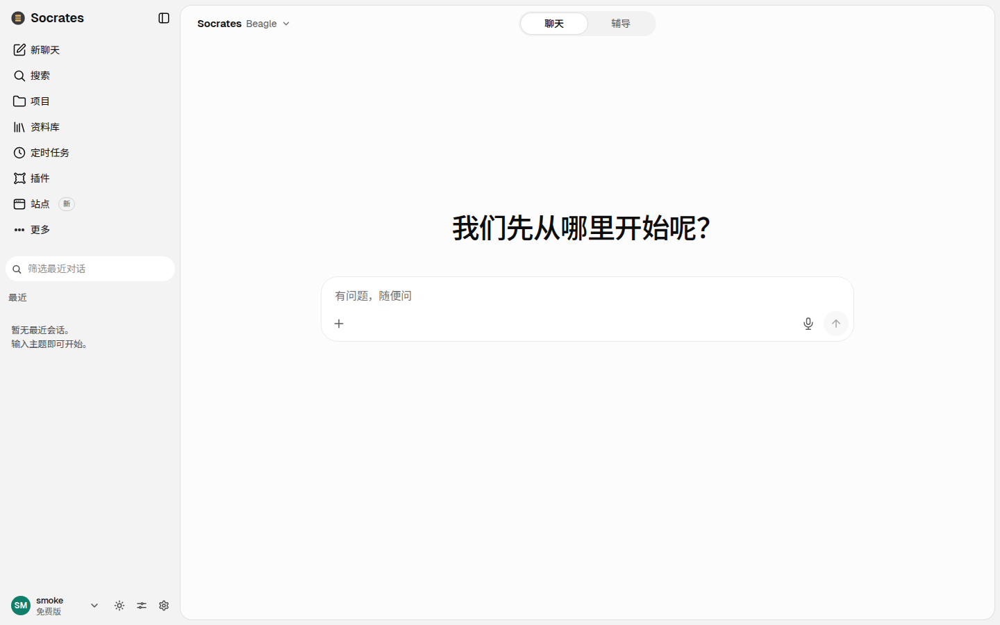
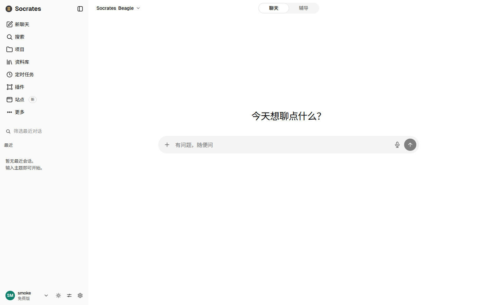
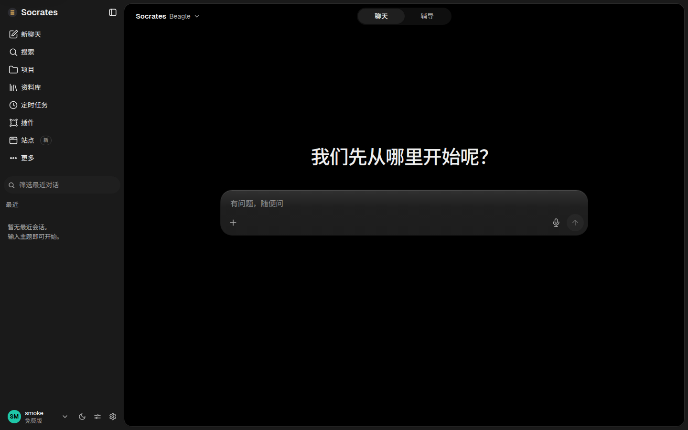
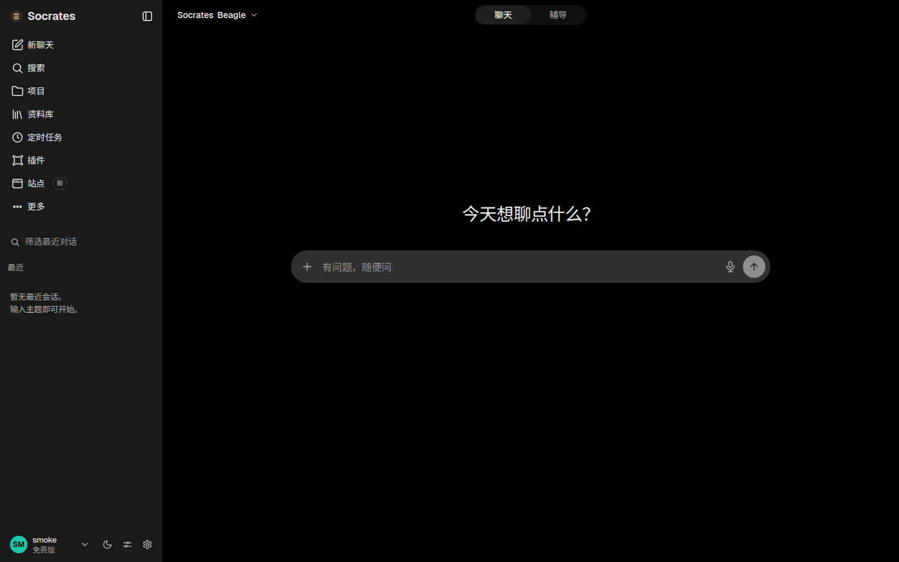
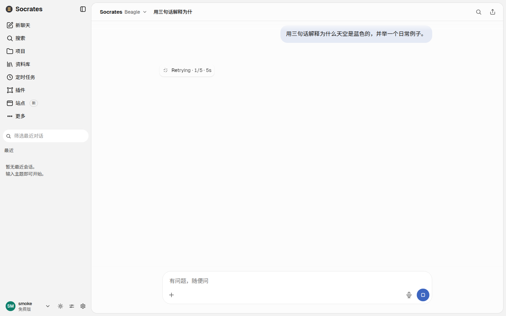
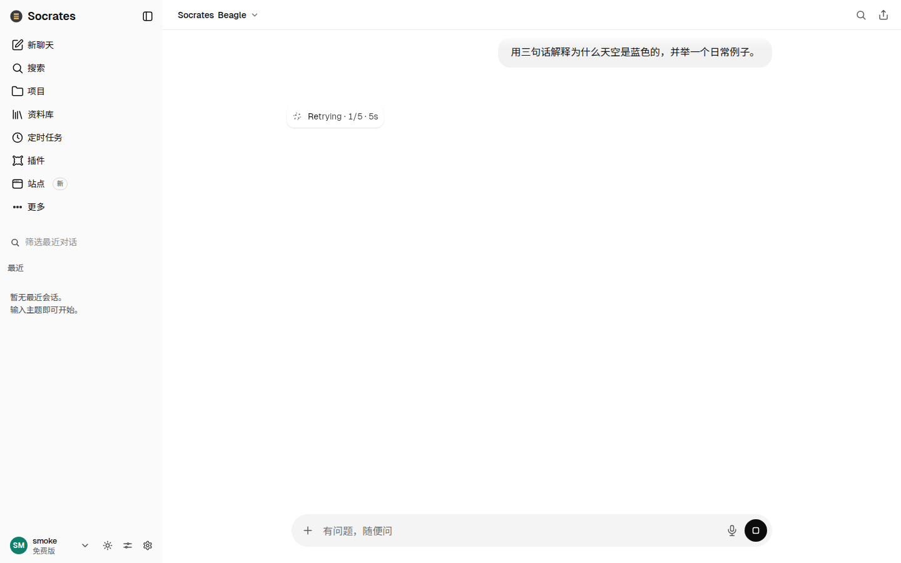
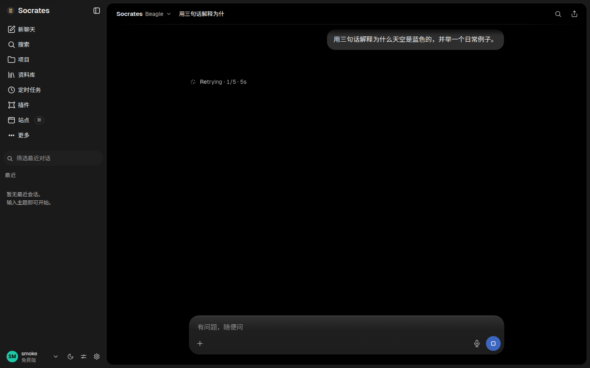
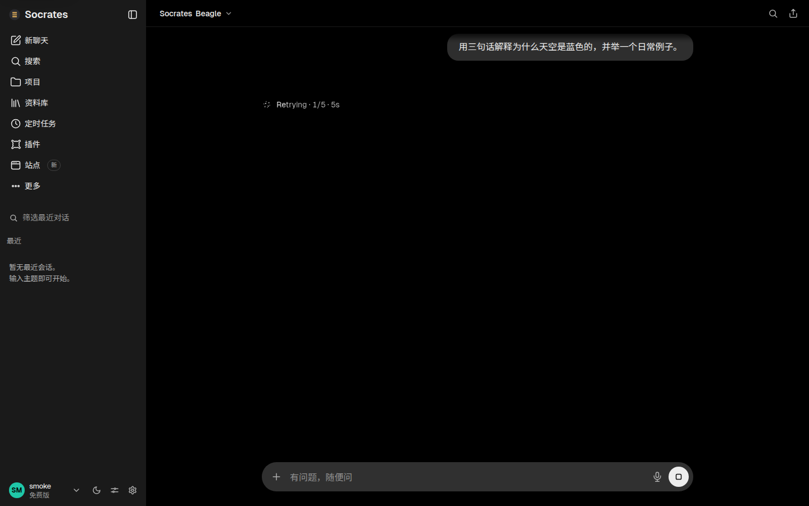
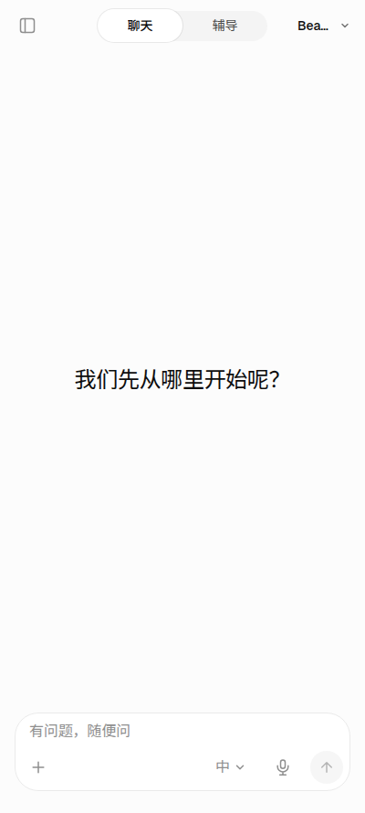
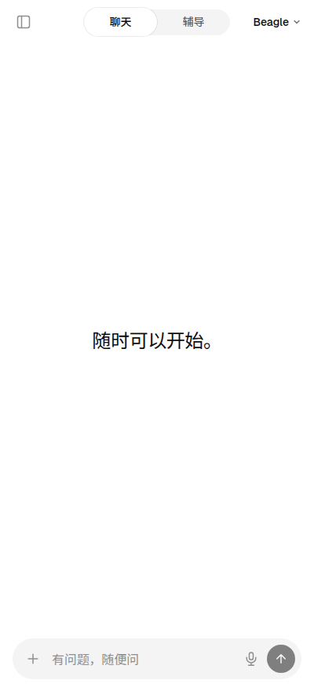

# 与 ChatGPT 对齐：Socrates UI 设计审计与改造

> 2026-11-24 · 分支 `ui/chatgpt-alignment`
>
> 目标不是把 Socrates 做成 ChatGPT 的复制品，而是把它借来的「聊天产品语法」补完整：一块画布、一条侧栏、一个主角输入框、一套克制的字与色。产品自己的品牌、模式切换、资料库与工具链全部保留。

---

## 摘要

这次改造只做三件事，但每一件都贯穿到最底层：

1. **把「卡片里的聊天」改成「聊天就是页面」。** 去掉主区域的 8px 内缩、16px 圆角、描边与投影，让画布从侧栏边缘一直铺到窗口边缘；侧栏与画布只靠一档色阶分开。
2. **把「编辑式标题 + 表单式输入框」改成「一句话 + 一个胶囊」。** 首页问候从 40px/500 的 Newsreader 衬线，降到 28px/400 的界面无衬线；输入框从「文本区 + 控件栏」两层结构，改成 52px 单行胶囊，加号在左，麦克风与墨色发送键在右。
3. **把「蓝色点缀的浅灰界面」改成「单色 chrome + 中性表面」。** 用户气泡从淡蓝紫混合色改成中性灰；主操作从蓝色改成墨色；蓝色只留给链接、焦点与选择；浅色画布改为纯白，深色画布保持纯黑，输入框在两种模式下分别是 `#f4f4f4` 与 `#303030`。

改动覆盖 20 个文件，全部通过类型检查、构建与仓库现有的表面归属、表面阶梯、输入框、字重、焦点环、移动端 CSS、设计债、按钮尺寸与令牌生成守卫。

---

## 一、ChatGPT 的设计语言

ChatGPT 的界面之所以「看起来什么都没做」，是因为它把复杂度都收进了几条不变的规则里。下面这些结论来自对 ChatGPT 公开界面、社区主题实现与多组深浅色截图的交叉比对，重点是可执行的测量值，而不是形容词。

### 1. 结构：一块画布，一条侧栏

- 对话区不是页面里的卡片，而是页面本身。没有外框、没有圆角、没有投影。
- 侧栏是画布下方一档的色阶，不是一条被画出来的边。浅色约 `#f9f9f9` 对 `#ffffff`，深色约 `#171717` 对 `#000000`。
- 画布与侧栏之间没有 1px 分割线。色阶本身就是分割线。
- 顶栏是画布的一部分：透明、无玻璃、无固定下边线；只有内容滚到它下面时才出现一条 hairline。

### 2. 字体：只有一套声音

- 全站一套无衬线（Söhne / 系统 UI 栈），没有展示体、没有衬线、没有第二套品牌字。
- 正文 `16/28`，界面标签 `14/20`，元信息 `12/16`。
- 首页问候 `28/36`，字重 `400`，字距约 `-0.02em`。它是一句写下来的话，不是营销标题。
- 标题用 `600` 建立层级，正文 `400`；几乎不用 `700`。
- 层级靠字号、字重、行高与留白，不靠颜色。

### 3. 色彩：单色 chrome，语义色只做语义

- 浅色：画布 `#ffffff`，侧栏 `#f9f9f9`，卡片 `#f7f7f7`，用户气泡 `#f3f3f3` 左右，边线 `#e7e7e7`。
- 深色：画布 `#000000`，侧栏 `#171717`，卡片 `#212121`，用户气泡 `#202020–#303030`，边线 `#2a2a2a`。
- 主操作是墨色：浅色黑底白字，深色白底黑字。蓝色只用于链接、焦点、选择与少量状态。
- 危险、成功、警告只在真正表达状态时出现，不做装饰。
- 输入框不是白色卡片，而是一块比画布略深的填充：浅色 `#f4f4f4`，深色 `#303030`。

### 4. 形状：4 / 8 / 10 / 12 / 20 的阶梯

- 小标记与代码行内块：`4`
- 菜单项、侧栏行：`8`
- 菜单容器、输入框内控件：`10–12`
- 卡片与面板：`12–16`
- 输入框胶囊：`26–28`
- 头像与圆形按钮：`999`

圆角不是越大越「现代」。ChatGPT 的圆角始终比容器小一档，控件永远「嵌」在容器里，而不是和容器一样圆。

### 5. 密度与控件

- 侧栏行 `36px`，图标 `18px`，行内边距 `10–12px`，行与行之间 `1–2px`。
- 顶栏 `44–48px`，图标按钮 `32px`，模型选择器 `32px` 高。
- 输入框最小 `52px`，内边距 `8px`，控件 `32–36px`。
- 图标统一 `1.5px` 描边，不用实心面。
- 按压不缩放。反馈是背景变深或透明度变化，不是「弹一下」。

### 6. 渐进披露

- 每条消息的操作栏默认隐藏，指针进入或键盘聚焦才出现；最后一条助手消息的操作栏常显。
- 侧栏行的「更多」按钮只在 hover / focus 时出现。
- 菜单、工具、模型参数都收在触发器后面，不预先铺满页面。
- 页面上永远只有一个「最重」的对象：首页是输入框，对话页是最后一条回答。

### 7. 空态即邀请

- 首页只有一句问候和一个输入框。没有功能卡片、没有三连建议、没有插图。
- 问候语与输入框组成一个光学组，略高于几何中心。
- 输入框本身承担了「你可以从这里开始」的全部说明，placeholder 就是邀请。

### 8. 动效

- `150–200ms`，`ease-out`，只动透明度和很小的位移。
- 菜单从触发器方向轻微缩放进入，不做弹簧。
- 主题切换、消息出现、工具展开都不使用大幅位移。
- `prefers-reduced-motion` 下全部退化为即时切换。

### 9. 深浅色不是反色

- 深色模式不是把浅色倒过来，而是重新排一遍表面：纯黑画布、更低的边界对比、更暗的卡片、更柔和的阴影。
- 深色的文字对比略低于浅色，避免在黑底上「发光」。
- 深色的输入框比画布亮一档，浅色的输入框比画布暗一档；两者都是「填充」，不是「白纸」。

### ChatGPT 关键测量值（本次采用的参照）

| 项目 | 浅色 | 深色 |
| --- | --- | --- |
| 画布 | `#ffffff` | `#000000` |
| 侧栏 | `#f9f9f9` | `#171717` |
| 卡片 / 菜单 | `#f7f7f7` | `#212121` |
| 输入框填充 | `#f4f4f4` | `#303030` |
| 用户气泡 | `#f3f3f3` | `#2f2f2f` |
| 边线 | `#e7e7e7` | `#2a2a2a` |
| 正文 | `16/28` | `16/28` |
| 问候语 | `28/36`，`400` | 同左 |
| 输入框 | `52px` 高，`28px` 圆角 | 同左 |
| 顶栏 | `44–48px` | 同左 |
| 侧栏行 | `36px`，`8px` 圆角 | 同左 |

参考来源：社区 Codex/ChatGPT 主题实现（<https://hermes-agent.nousresearch.com/marketplace/codex-theme>）与界面拆解文章（<https://www.925studios.co/blog/chatgpt-interface-design-breakdown>），并用多组深浅色截图交叉核对。

---

## 二、改造前诊断

改造前的 Socrates 并不「丑」，它的问题是把营销站的卡片语言搬进了聊天产品：每个区域都在努力证明自己是一个独立的卡片，结果聊天本身不再是主角。



| # | 位置 | 改造前 | 问题 |
| --- | --- | --- | --- |
| 1 | 主区域 | `.main` 四边内缩 `8px`，`.main-bg` 是 `16px` 圆角卡片，带描边与投影 | 聊天被装进一个浮动卡片，和 ChatGPT 的整块画布相反 |
| 2 | 侧栏 | `#fafafa` 对画布 `#fcfcfc`，对比几乎为零 | 两个区域分不开，只能靠卡片边框「造」边界 |
| 3 | 侧栏选中 | 白色卡片 + `raised` 投影 | 选中行像浮起来的名片，噪音大 |
| 4 | 搜索 | 白色胶囊 + 1px ring | 比所有导航行都重，抢走注意力 |
| 5 | 问候语 | `Newsreader` 衬线，`40px/500`，字距 `-0.9px` | 像杂志标题，不像聊天产品的邀请 |
| 6 | 输入框 | 两层：文本区 + 底部控件栏；`24px` 圆角；白色纸面 + 大投影；深色还有渐变和高光 | 是一个「表单」，不是一个「提问的地方」 |
| 7 | 发送键 | 蓝色 `#3d66c0`；空态是几乎看不见的 4% 填充 | 蓝色不是 ChatGPT 的主操作语言；空态辨识度太低 |
| 8 | 用户气泡 | 浅色是蓝色 12% 混合，深色 `#1a1a1a`；`20px` 圆角，`10×16` 内边距 | 浅色偏蓝紫，深色偏暗；内边距偏紧 |
| 9 | 正文 | `16/30`，字距 `normal` | 行高偏松，长文读起来散 |
| 10 | 顶栏 | `52px`，玻璃模糊，浅色再改成实色；会话标题与模型名并列 | 比参考更重、更吵；标题和对话内容重复 |
| 11 | 模型选择器 | 品牌 `600` 深色，模型 `400` 灰色 | 一个控件里出现两个层级，读起来断裂 |
| 12 | 菜单 | `16px` 圆角，浅色只有 1px ring | 圆角偏大，浮层缺少「离开页面」的投影 |

---

## 三、改造方案

改造顺序是「令牌 → 外壳 → 组件 → 细节」。先改单一来源，再让所有使用方一起变；避免在几十个选择器里逐个打补丁。

### 3.1 令牌层：先把尺子换掉

| 令牌 | 改造前 | 改造后 | 作用 |
| --- | --- | --- | --- |
| `uiType.greeting` | `40/48`，`500`，`-0.9` | `28/36`，`400`，`-0.56` | 首页问候回到「一句话」 |
| `uiType.greetingCompact` | `24/32`，`500` | `24/32`，`400` | 手机问候减重 |
| `uiType.body` | `16/26`，`0` | `16/28`，`-0.1` | 正文行高与字距对齐参考 |
| `uiType.bodySm` | `14/22`，`0` | `14/22`，`-0.06` | 次级文本更紧 |
| `uiColors.light.canvas` | `#fcfcfc` | `#ffffff` | 浅色画布就是白纸 |
| `uiRadius.composer` | 无 | `28` | 输入框胶囊的单一来源 |
| `--ui-radius-row` | `12px` | `8px` | 侧栏行、菜单项 |
| `--ui-radius-popover` | `16px` | `12px` | 菜单容器 |
| `--ui-bg-ask` | 无 | `#f4f4f4` / `#303030` | 输入框填充，独立于表面阶梯 |
| `--ui-bg-bubble` | `#f2f2f2` / `#2e2e2e` | 保持 | 中性灰气泡 |
| `--ui-bg-code` | `#ffffff` / `#1f1f1f` | `#f2f2f2` / `#0a0a0a` | 代码块从页面里「凹」下去 |

`ui.ts` 是唯一来源，改完必须跑 `npm run generate:ui-tokens`。生成文件 `tokens.generated.css` 不手改。

输入框填充为什么单独叫 `--ui-bg-ask`？因为仓库的表面阶梯守卫要求 `--ui-bg-composer` 必须是四级阶梯上的一档；而 ChatGPT 的输入框是一个「字段色」，不是阶梯上的纸面。把字段色拆出来后，阶梯仍然成立，输入框也能拿到正确的 `#f4f4f4` / `#303030`。

### 3.2 外壳：从「卡片」到「画布」

`frontend/src/styles/parity/sidebar.css`

- `.main` 的 `padding` 归零，只保留 `padding-left: var(--app-sidebar-width)` 作为侧栏偏移。
- `.main-bg` 改为 `inset: 0 0 0 var(--app-sidebar-width)`，`border-radius: 0`，`box-shadow: none`，背景 `var(--ui-canvas)`。
- `.main-content` 去掉底部圆角。
- `#appShell` 背景改为 `var(--ui-bg-rail)`；侧栏透明、无右边框。两个区域只靠 `#fafafa` 与 `#ffffff` 的色阶分开。
- 顶栏、主内容都不再需要「卡片顶部圆角」的补丁，相关重复规则已删除。

### 3.3 侧栏：把「卡片」降为「行」

- 导航行圆角 `8px`，行高保持 `36px`；hover 是 4–6% 的中性 wash，选中是 8% 墨色 wash（比 hover 深一档），选中不再有白色卡片与投影。
- 搜索从白色胶囊改成裸行：静止透明，hover 一档 wash，只有 `focus-within` 时出现一条内描边。
- 关闭侧栏按钮 hover 同样改为中性 wash。
- 分组标题去掉 `text-transform: uppercase` 与字距，回到句首大写的安静标签。
- 侧栏品牌、行图标与文字层级保留，不做「去品牌化」。

### 3.4 顶栏：降高、去玻璃、减信息

`frontend/src/styles/parity/topbar.css`、`packages/ui/src/shell/TopBar.tsx`

- 高度 `52px → 48px`，左右内边距 `24px → 16px`。
- 去掉 `backdrop-filter` 与玻璃背景；顶栏透明，只有滚动时才出现一条 hairline。
- 桌面隐藏会话标题。参考里顶栏只回答「用哪个模型」，不重复「这是哪个对话」。
- 模型选择器统一为 `14px/500` 的单一标签：品牌与模型同字号、同字重、同墨色，箭头 `14px` 三级灰。
- 顶栏图标按钮与模型选择器高度 `36px → 32px`。
- 模式切换从 `198×36` 收到 `180×32`，滑块 `28px`，仍保持胶囊与白底滑块的语言。

### 3.5 输入框：从「两层表单」到「一行胶囊」

这是改动最深的一处，涉及共享组件与 Web 宿主。

`packages/ui/src/composer/ComposerFrame.tsx`

- 新增 `layout: 'stacked' | 'inline'`。`inline` 把「工具 / 编辑器 / 发送」放在同一行；`stacked` 保留给需要两层结构的原生宿主。
- 新增 `surface`，让 Web 传入 `var(--ui-bg-ask)`，原生仍默认卡片纸面。
- `inline` 下：`8px` 内边距、`minHeight 36`、`alignItems: flex-end`，文本区 `flex: 1`，圆角桌面 `28px`、手机 `26px`。
- 桌面与手机都使用 `inline`；手机隐藏 effort chip，改由模型选择器里的参数面板承载，避免在 400px 宽里塞五个控件。
- 焦点不再靠外投影，而是在胶囊内部画一条 `--ui-hairline-strong` 的内描边。

`packages/ui/src/composer/ComposerControls.tsx`

- 新增 `part: 'all' | 'leading' | 'trailing'`，让同一套控件可以拆到编辑器两侧：`leading` 只有加号，`trailing` 是 effort / 计时 / 麦克风 / 发送。
- 发送键从 `colors.action`（蓝）改为 `colors.ink`（墨），图标 `colors.onInk`；空态用 `0.5` 透明度，仍然是一个可辨识的实心圆。
- 按压只改透明度，不缩放。

`frontend/src/react/composer-input/ComposerShell.tsx`

- `layout="inline"`、`surface="var(--ui-bg-ask)"`。

`frontend/src/styles/parity/composer-unified.css`

- 内联胶囊：`background-image: none`、`box-shadow: none`，并关闭浅色模式的 `::before` 外描边；只有 `[data-focused='true']` 时加内描边。
- 深色模式的渐变高光只保留给 `stacked`，不再污染内联胶囊。

### 3.6 对话流：让文字回到阅读

`frontend/src/styles/parity/transcript.css`

- 正文行高 `30px → 28px`，字距改为 `var(--ui-type-body-tracking)`（`-0.1px`）。
- 用户气泡内边距 `10×16 → 10×20`，最大宽度仍为 `70%`，圆角保持 `20px`。
- 用户气泡颜色统一为 `var(--ui-bg-bubble)`：浅色 `#f2f2f2`，深色 `#2e2e2e`。浅色不再混入 12% 的蓝色。
- 助手正文仍是 `16/28`，段落间距 `16px`，标题 `600`，与参考一致。
- 消息操作栏保持「最后一条常显、其余 hover/focus 显示」，按钮仍是 `32px`、`1.5px` 描边。

### 3.7 菜单与代码块

- 菜单容器 `16px → 12px`，浅色投影从「只有 1px ring」改为「ring + 2px 接触阴影 + 12px 环境阴影」，浮层终于离开页面。
- 菜单项圆角随 `--ui-radius-row` 收到 `8px`。
- 代码块浅色从白纸改为 `#f2f2f2`，深色从 `#1f1f1f` 改为 `#0a0a0a`；代码块在页面里是「凹槽」，不是另一张卡片。

### 3.8 移动端

- 输入框同样改为单行 `52px` 胶囊，圆角 `26px`；加号、文本、麦克风、发送一行排布。
- 模型 chip 最大宽度从 `76px` 放宽到 `108px`，`Beagle` 不再被截成 `Bea...`。
- 手机问候 `24/32`、`400`，保持一行。
- 移动端顶栏仍保留模式切换与模型 chip，但控件高度、留白与桌面同一套令牌。

---

## 四、前后对比

### 浅色桌面首页

| 改造前 | 改造后 |
| --- | --- |
|  |  |

### 深色桌面首页

| 改造前 | 改造后 |
| --- | --- |
|  |  |

### 浅色桌面对话

| 改造前 | 改造后 |
| --- | --- |
|  |  |

### 深色桌面对话

| 改造前 | 改造后 |
| --- | --- |
|  |  |

### 移动端首页

| 改造前 | 改造后 |
| --- | --- |
|  |  |

---

## 五、验证

### 构建与类型

- `npx vite build`：通过。
- `npx tsc --noEmit`：除本地预览用的 `wasm/socrates_wasm.js` stub 缺少声明外，无错误；该目录被 `.gitignore` 忽略，不进入提交。
- `npm run generate:ui-tokens`：生成文件与 `packages/theme/src/ui.ts` 一致。

### 设计守卫

| 守卫 | 结果 |
| --- | --- |
| `lint:surface-css` | 通过（侧栏、顶栏、对话、输入框单一归属；重复声明已清理） |
| `lint:surface-ladder` | 通过（浅色 `#ffffff → #fafafa → #f2f2f2 → #ffffff`，深色 `#000000 → #1a1a1a → #1f1f1f → #292929`） |
| `lint:composer-css` | 通过（输入框仍由 `parity/composer-unified.css` 单一持有） |
| `lint:font-weight` | 通过（0 处字面字重，284 处令牌引用） |
| `lint:focus-ring` | 通过（深色 5.82:1，浅色 4.07:1） |
| `lint:mobile-css` | 通过 |
| `lint:css-debt` | 通过（未新增设计债） |
| `lint:button-sizes` | 通过（0 处越级声明） |
| `lint:ui-tokens` | 通过 |

### 关键计算样式（1440×900，浅色）

| 元素 | 实测 |
| --- | --- |
| 首页问候 | `28px/36px`，`400`，`-0.56px`，Geist Sans |
| 输入框胶囊 | `768×52`，`28px` 圆角，`#f4f4f4`，无投影，`8px` 内边距 |
| 顶栏 | `48px` 高，透明，无玻璃 |
| 侧栏行 | `36px` 高，`8px` 圆角 |
| 正文 | `16px/28px` |
| 用户气泡 | `20px` 圆角，`10×20` 内边距，`#f2f2f2` |

### 移动端（400×890，浅色）

| 元素 | 实测 |
| --- | --- |
| 输入框胶囊 | `368×52`，`26px` 圆角，`#f4f4f4`，无投影 |
| 问候 | `24px/32px`，`400` |
| 顶栏 | `56px` 高（保留安全区与模式切换） |

### 视觉基线

菜单圆角与投影调整后，已重新生成 8 张 Linux 基线快照，并跑通视觉测试：

```bash
cd frontend
npx playwright test e2e/composer-tools-visual-baseline.spec.mjs --update-snapshots
npx playwright test e2e/composer-tools-visual-baseline.spec.mjs --project=visual
```

结果：`1 passed`。菜单高度从 `418px` 变为 `424px`（圆角与内边距调整），截图差异约 7%，属于本次有意的视觉变更。Windows 基线未在本机重新生成；Playwright 配置把截图类 spec 归为 advisory，不会阻塞合并。

---

## 六、改动文件

| 文件 | 改动 |
| --- | --- |
| `packages/theme/src/ui.ts` | 问候/正文字阶、`composer` 圆角、浅色画布 |
| `packages/theme/src/tokens.ts` | 浅色 page `#ffffff`、首屏背景 |
| `packages/theme/src/rn.ts` | 原生投影的 page / composer 同步 |
| `frontend/src/styles/foundations/tokens.generated.css` | 由生成器产出，不手改 |
| `frontend/src/styles/themes.css` | 画布、输入框字段色、气泡、代码块、菜单投影 |
| `frontend/src/styles/tokens.css` | 行圆角 `8`、菜单圆角 `12` |
| `frontend/src/styles/parity/sidebar.css` | 整块画布、裸搜索、中性选中、分组标题 |
| `frontend/src/styles/parity/topbar.css` | `48px`、去玻璃、隐藏会话标题、去重复卡片圆角 |
| `frontend/src/styles/parity/composer-unified.css` | 内联胶囊的扁平表面与焦点内描边 |
| `frontend/src/styles/parity/transcript.css` | `16/28`、气泡内边距与字距 |
| `frontend/src/styles/polish/sidebar.css` | hover / 搜索状态与 parity 对齐 |
| `frontend/src/styles/polish/composer.css` | 问候语去衬线、去重字重覆盖 |
| `frontend/src/styles/legacy/05-chat-landing.css` | `.topic-title` 改为 28px 无衬线 |
| `packages/ui/src/home/HomeEmptyState.tsx` | 去掉流体字号与衬线入口 |
| `frontend/src/react/home/HomeStartComponents.tsx` | 不再传入 `--font-display` |
| `packages/ui/src/composer/ComposerFrame.tsx` | `inline` 布局、`surface`、单行结构 |
| `packages/ui/src/composer/ComposerControls.tsx` | `part` 拆分、墨色发送键 |
| `frontend/src/react/composer-input/ComposerShell.tsx` | 启用内联布局与字段色 |
| `packages/ui/src/shell/TopBar.tsx` | 32px 控件、统一模型标签、32px 模式切换 |
| `frontend/scripts/surface-ladder.baseline.json` | 浅色 page 改为 `#ffffff`，移除过时的 paperTint |
| `frontend/e2e/composer-tools-visual-baseline.spec.mjs-snapshots/*-chromium-linux.png` | 8 张菜单视觉基线重新生成 |

---

## 七、后续建议

1. **统一图标尺寸。** 侧栏目前是 20px 图标配 36px 行；参考更接近 18px。可以把共享 `SidebarNavRow` 的 glyph 盒从 20 收到 18，但会牵动 Android 端，建议单独一轮做。
2. **收敛侧栏底部。** 现在「账户 + 主题 + 显示 + 设置」四个对象并排；ChatGPT 只有一个账户行。可以把三个图标收进账户行的「更多」，但需要先确认设置入口的可发现性。
3. **移动端抽屉对齐。** 桌面侧栏已经是裸行 + wash，手机抽屉仍是另一套圆角与间距；下一轮可以把 `polish/mobile-sidebar.css` 的令牌接到同一套行几何上。
4. **字体实验。** 目前用 Geist Sans 作为 Söhne 的近似。如果希望更接近 ChatGPT 的窄字宽，可以做一次 `system-ui` 对照实验，但不要同时保留两套 UI 字族。
5. **对话状态条。** `Retrying · 1/5 · 5s` 仍是白色小卡片；参考里这类状态是纯文字 + 小 spinner。可以把它降为无底色的一行，进一步减少对话区的「卡片感」。
